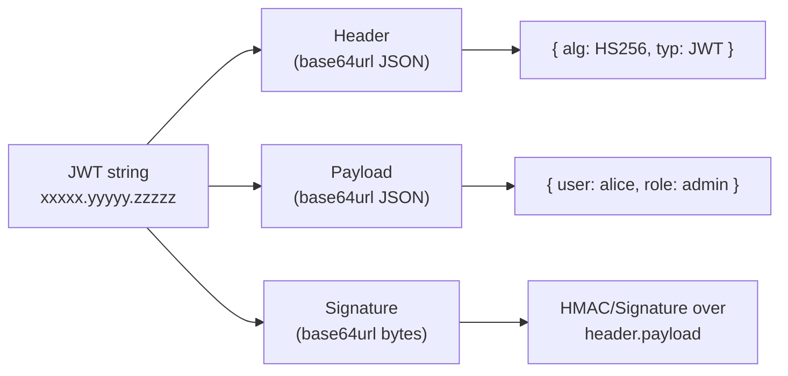
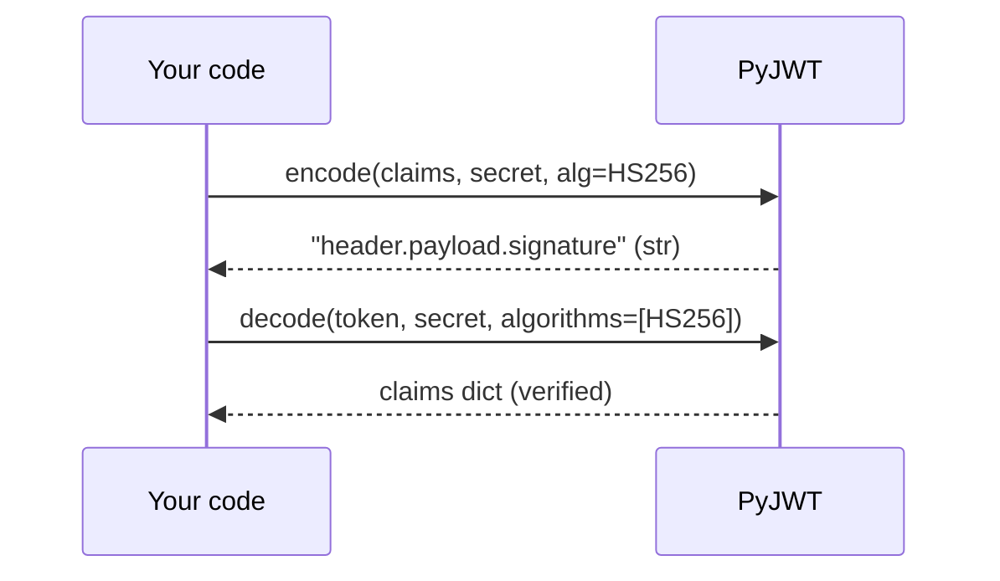

# 🧱 Module 01 · Foundations — What a JWT *actually* is

> Before you sign anything, encrypt anything, or wire up an auth flow, you need
> to understand what a JSON Web Token **is at the byte level**. This module
> strips a JWT down to its raw pieces and rebuilds your mental model from
> scratch.

---

## 🎯 What you'll learn

A signed JWT is deceptively simple: **three base64url-encoded chunks joined by
dots**.

```
header . payload . signature
```

- The **header** is a tiny JSON object saying *how* the token was signed.
- The **payload** is JSON carrying *claims* (data about a user/session).
- The **signature** is raw cryptographic bytes proving the first two parts
  weren't tampered with.

The single most important takeaway of this module: a JWT is **signed, not
encrypted**. Anyone can read the payload — the signature only guarantees
*integrity*, never *confidentiality*.

---

## 🗺️ JWT structure at a glance





---

## 📜 Scripts in this module

| # | Script | What it teaches | Run command |
|---|--------|-----------------|-------------|
| 01 | [01_anatomy_of_a_jwt.py](01_anatomy_of_a_jwt.py) | Split a token on `.` and label the 3 parts | `.venv/bin/python pyjwt-course/01-foundations/01_anatomy_of_a_jwt.py` |
| 02 | [02_base64url_decode.py](02_base64url_decode.py) | Manually base64url-decode header & payload; why base64url | `.venv/bin/python pyjwt-course/01-foundations/02_base64url_decode.py` |
| 03 | [03_header_vs_payload_vs_signature.py](03_header_vs_payload_vs_signature.py) | Pretty-print header & payload dicts; signature is raw bytes | `.venv/bin/python pyjwt-course/01-foundations/03_header_vs_payload_vs_signature.py` |
| 04 | [04_decode_without_verification.py](04_decode_without_verification.py) | Read claims with `verify_signature: False`; the danger | `.venv/bin/python pyjwt-course/01-foundations/04_decode_without_verification.py` |
| 05 | [05_jwt_is_signed_not_encrypted.py](05_jwt_is_signed_not_encrypted.py) | Prove anyone can read the payload — never store secrets | `.venv/bin/python pyjwt-course/01-foundations/05_jwt_is_signed_not_encrypted.py` |
| 06 | [06_tampering_breaks_signature.py](06_tampering_breaks_signature.py) | Tamper with a payload → `InvalidSignatureError` | `.venv/bin/python pyjwt-course/01-foundations/06_tampering_breaks_signature.py` |
| 07 | [07_get_unverified_header.py](07_get_unverified_header.py) | Read `alg`/`kid` with `get_unverified_header` | `.venv/bin/python pyjwt-course/01-foundations/07_get_unverified_header.py` |
| 08 | [08_encode_decode_roundtrip.py](08_encode_decode_roundtrip.py) | Minimal full HS256 round trip, stage by stage | `.venv/bin/python pyjwt-course/01-foundations/08_encode_decode_roundtrip.py` |

> Run them in order — each builds on the previous one.

---

## 🔑 Key takeaways

1. **Three parts, always.** A signed JWT is `header.payload.signature`. Splitting
   on `.` is the first thing every JWT library does.
2. **base64url, not base64.** The `-`/`_` alphabet and dropped `=` padding make
   tokens URL- and header-safe. You must re-add padding when decoding by hand.
3. **The payload is public.** It's just encoded JSON. Decoding needs *no key*.
4. **The signature provides integrity.** Change one byte → verification fails.
5. **Unverified reads are hints, not trust.** `verify_signature: False` and
   `get_unverified_header` are for *setting up* verification (e.g. picking a
   key), never for authorization.

---

## ⚠️ Common pitfalls

- ❌ **"It's encrypted, so I'll store the user's password in it."** No — anyone
  can read the payload. Never put secrets in a JWT.
- ❌ **Trusting an unverified decode.** Reading claims without checking the
  signature gives you *attacker-controlled* data.
- ❌ **Forgetting `=` padding** when decoding base64url manually → `binascii`
  errors. Pad to a multiple of 4 first.
- ❌ **Assuming `decode()` is optional about `algorithms=`.** It's required in
  PyJWT 2.x; you'll see why in module 02.

---

## ➡️ Next up

**[Module 02 · Getting started with HS256](../02-getting-started-hs256/)** — your
first real encode/decode, secret strength, `str` vs `bytes`, and a tiny login
simulation.
