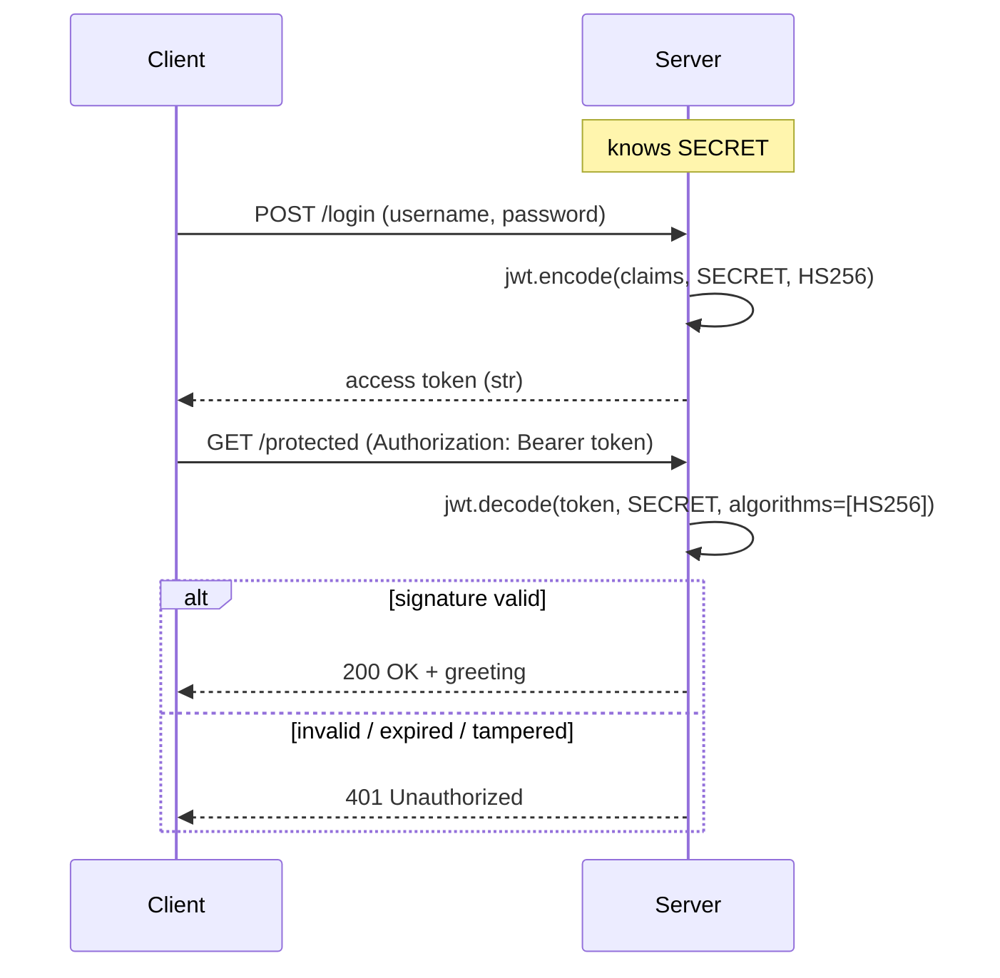

# 🚀 Module 02 · Getting Started with HS256

> You understand what a JWT *is* (Module 01). Now let's actually **use** one.
> This module is your hands-on introduction to issuing and verifying tokens with
> **HS256** — the shared-secret workhorse of JWT signing.

---

## 🎯 What you'll learn

**HS256** = **H**MAC with **S**HA-**256**. It's a *symmetric* algorithm: the
**same secret** both signs and verifies a token. It's simple, fast, and perfect
when one party (or a set of trusted services sharing a secret) issues *and*
checks tokens.

You'll learn the two core calls and the habits that keep them safe:

```python
token  = jwt.encode({"user": "alice"}, secret, algorithm="HS256")   # issue
claims = jwt.decode(token, secret, algorithms=["HS256"])            # verify
```

…plus `str` vs `bytes`, why `algorithms=` is mandatory, what value types a
payload accepts, how to generate a *strong* secret, and a tiny end-to-end login.

---

## 🔄 The HS256 issue/verify loop



---

## 📜 Scripts in this module

| # | Script | What it teaches | Run command |
|---|--------|-----------------|-------------|
| 01 | [01_first_encode.py](01_first_encode.py) | Issue your first token with `encode()` | `.venv/bin/python pyjwt-course/02-getting-started-hs256/01_first_encode.py` |
| 02 | [02_first_decode.py](02_first_decode.py) | Verify & read it back with `decode()` | `.venv/bin/python pyjwt-course/02-getting-started-hs256/02_first_decode.py` |
| 03 | [03_str_vs_bytes.py](03_str_vs_bytes.py) | `encode()` returns `str`; `str` vs `bytes` secrets | `.venv/bin/python pyjwt-course/02-getting-started-hs256/03_str_vs_bytes.py` |
| 04 | [04_wrong_secret_fails.py](04_wrong_secret_fails.py) | Wrong secret → `InvalidSignatureError` | `.venv/bin/python pyjwt-course/02-getting-started-hs256/04_wrong_secret_fails.py` |
| 05 | [05_must_specify_algorithms.py](05_must_specify_algorithms.py) | Why `algorithms=` is required | `.venv/bin/python pyjwt-course/02-getting-started-hs256/05_must_specify_algorithms.py` |
| 06 | [06_payload_types.py](06_payload_types.py) | Allowed value types; `datetime` for date claims | `.venv/bin/python pyjwt-course/02-getting-started-hs256/06_payload_types.py` |
| 07 | [07_secret_strength.py](07_secret_strength.py) | Generate strong secrets; HMAC entropy needs | `.venv/bin/python pyjwt-course/02-getting-started-hs256/07_secret_strength.py` |
| 08 | [08_full_login_simulation.py](08_full_login_simulation.py) | A complete issue-then-verify login flow | `.venv/bin/python pyjwt-course/02-getting-started-hs256/08_full_login_simulation.py` |

---

## 🔑 Key takeaways

1. **Two calls do everything.** `encode()` issues, `decode()` verifies + reads.
2. **`encode()` returns `str`** in PyJWT 2.x (it was `bytes` in 1.x — beware old
   tutorials that call `.decode('utf-8')` on the result).
3. **Secrets can be `str` or `bytes`** — a `str` is UTF-8 encoded internally, so
   `"abc"` and `b"abc"` are the same key. Be consistent.
4. **Always pin `algorithms=[...]`** on decode. It's required *and* it's your
   defense against `alg=none` and algorithm-confusion attacks.
5. **Secret strength is everything.** HS256 is only as strong as its key — use
   ≥ 32 random bytes from `secrets`/`os.urandom`.

---

## ⚠️ Common pitfalls

- ❌ **Copy-pasting `token.decode('utf-8')`** from a PyJWT 1.x guide → crashes,
  because `encode()` already returns `str`.
- ❌ **Weak/guessable secrets** (`"secret"`, `"password123"`) → tokens forgeable
  via offline brute force. The HMAC math can't save a bad key.
- ❌ **Deriving `algorithms=` from the token's own header** → reintroduces the
  exact attack the allow-list exists to prevent.
- ❌ **Putting the verify secret on the client.** With HS256 the secret both
  signs *and* verifies — anyone who has it can forge tokens. Keep it server-side
  only. (Need clients to verify without forging? That's asymmetric signing —
  RSA/ECDSA/EdDSA, coming in later modules.)

---

## ➡️ Next up

**Module 03 · Registered claims** — `iss`, `sub`, `aud`, `exp`, `nbf`, `iat`,
`jti`, and how PyJWT validates them automatically.
