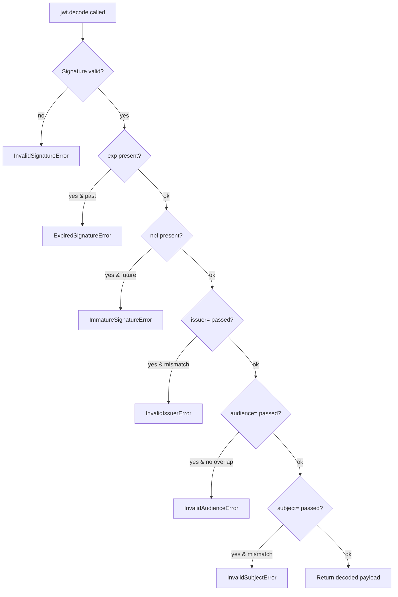

# 🪪 Module 03 · Registered Claims

> The JWT spec ([RFC 7519 §4.1](https://www.rfc-editor.org/rfc/rfc7519#section-4.1))
> reserves a handful of short, three-letter claim names with agreed-upon
> meanings. They are registered with [IANA](https://www.iana.org/assignments/jwt/jwt.xhtml).
> This module walks through all **seven** and shows *exactly* how PyJWT 2.13
> validates each one.

---

## 🧠 The big idea

A JWT payload is just JSON — you could put anything in it. The **registered
claims** are the seven names everyone agrees on, so that issuers and verifiers
speak the same language about *who*, *for whom*, and *when*.

| Claim | Name | Meaning | Validated by PyJWT? |
|-------|------|---------|---------------------|
| `iss` | Issuer | Who created the token | Only if you pass `issuer=` |
| `sub` | Subject | Who the token is about | Only if you pass `subject=` |
| `aud` | Audience | Who the token is for | Only if you pass `audience=` |
| `exp` | Expiration | Reject at/after this time | ✅ Automatic when present |
| `nbf` | Not Before | Reject before this time | ✅ Automatic when present |
| `iat` | Issued At | When it was created | Future `iat` rejected (`verify_iat`) |
| `jti` | JWT ID | Unique token identifier | ❌ Your app must track it |

> 🔑 **Key distinction:** the *time* claims (`exp`, `nbf`) are checked
> automatically. The *identity* claims (`iss`, `sub`, `aud`) are opt-in — you
> must tell PyJWT what value to expect, or it won't look at them at all.

---

## 🌊 How PyJWT validates a token



---

## 📜 Scripts in this module

| # | Script | What it demonstrates | Run it |
|---|--------|----------------------|--------|
| 01 | [`01_iss_issuer.py`](01_iss_issuer.py) | Set & verify `iss`; `InvalidIssuerError` on mismatch | `.venv/bin/python pyjwt-course/03-registered-claims/01_iss_issuer.py` |
| 02 | [`02_sub_subject.py`](02_sub_subject.py) | Verify `sub` via `subject=`; mismatch & missing-claim errors | `.venv/bin/python pyjwt-course/03-registered-claims/02_sub_subject.py` |
| 03 | [`03_aud_audience.py`](03_aud_audience.py) | `aud` as a string; `InvalidAudienceError` on mismatch | `.venv/bin/python pyjwt-course/03-registered-claims/03_aud_audience.py` |
| 04 | [`04_aud_multiple.py`](04_aud_multiple.py) | `aud` as a list; set-intersection matching | `.venv/bin/python pyjwt-course/03-registered-claims/04_aud_multiple.py` |
| 05 | [`05_exp_expiration.py`](05_exp_expiration.py) | Future vs. expired `exp`; `ExpiredSignatureError` | `.venv/bin/python pyjwt-course/03-registered-claims/05_exp_expiration.py` |
| 06 | [`06_nbf_not_before.py`](06_nbf_not_before.py) | Future vs. past `nbf`; `ImmatureSignatureError` | `.venv/bin/python pyjwt-course/03-registered-claims/06_nbf_not_before.py` |
| 07 | [`07_iat_issued_at.py`](07_iat_issued_at.py) | `iat` is informational; custom freshness policy | `.venv/bin/python pyjwt-course/03-registered-claims/07_iat_issued_at.py` |
| 08 | [`08_jti_jwt_id.py`](08_jti_jwt_id.py) | `jti` with `uuid4`; in-memory denylist / replay defense | `.venv/bin/python pyjwt-course/03-registered-claims/08_jti_jwt_id.py` |
| 09 | [`09_all_claims_together.py`](09_all_claims_together.py) | One token, all 7 claims, every check enabled | `.venv/bin/python pyjwt-course/03-registered-claims/09_all_claims_together.py` |
| 10 | [`10_datetime_handling.py`](10_datetime_handling.py) | `datetime` → NumericDate conversion; int epoch too | `.venv/bin/python pyjwt-course/03-registered-claims/10_datetime_handling.py` |

Run the whole module:

```bash
for f in pyjwt-course/03-registered-claims/0*.py; do echo "== $f =="; .venv/bin/python "$f"; done
```

---

## ✅ Key takeaways

- **Time claims are automatic.** If `exp`/`nbf` are present, PyJWT enforces
  them with no extra arguments.
- **Identity claims are opt-in.** Without `issuer=`, `audience=`, or
  `subject=`, PyJWT will happily ignore `iss`, `aud`, and `sub`.
- **`aud` matching is set intersection.** A token valid for many audiences
  passes if *any* accepted value is present.
- **`datetime` objects are first-class.** Pass timezone-aware datetimes; PyJWT
  converts them to epoch seconds (NumericDate).
- **`jti` is yours to police.** PyJWT stores it; replay protection is your job.

---

## ⚠️ Pitfalls

- 🕳️ **Forgetting `audience=`.** A token minted for service A will pass at
  service B unless B verifies `aud`. Always check it.
- 🕳️ **Naive datetimes.** `datetime.now()` (no tz) is ambiguous. Use
  `datetime.now(timezone.utc)`.
- 🕳️ **Misjudging `iat`.** In PyJWT 2.13 a *future* `iat` raises
  `ImmatureSignatureError` (disable via `options={"verify_iat": False}`). It is
  still informational for *age* checks — enforce those yourself.
- 🕳️ **Treating `jti` as automatic replay protection.** Without a denylist it
  does nothing.
- 🕳️ **`exp` too far out.** Long-lived tokens are a security risk; prefer short
  lifetimes plus refresh.
