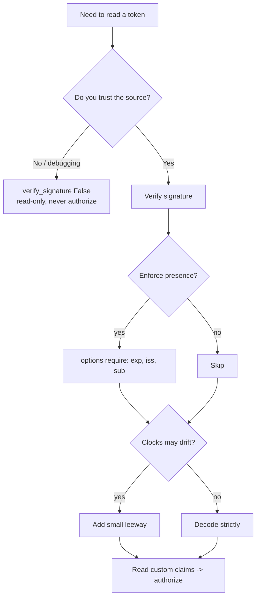

# 🧩 Module 04 · Custom Claims & Validation Options

> Registered claims (Module 03) are the shared vocabulary. **Custom claims** are
> where *your* application data lives — roles, tenant, email, feature flags. And
> `jwt.decode()`'s `options=`, `require=`, and `leeway=` knobs let you decide
> *exactly* how strict verification should be.

---

## 🧠 The big idea

A JWT payload is open-ended JSON. You can add any **private claim** your app
needs. The flip side is control: PyJWT applies sensible defaults, but you can
tighten verification (demand certain claims) or — carefully — loosen it (skip a
check). Knowing which knob does what, and the risk of each, is the heart of safe
token handling.

### The `decode()` control surface

| Knob | Purpose | Default |
|------|---------|---------|
| `options={"verify_signature": False}` | Read claims without trust | signature **is** verified |
| `options={"verify_exp": False}` | Accept expired tokens | `exp` **is** enforced |
| `options={"verify_aud": False}` | Skip audience check | `aud` checked when `audience=` given |
| `options={"require": [...]}` | Demand claims be present | nothing required |
| `leeway=timedelta(...)` | Grace window for clock skew | `0` |

---

## 🌊 Choosing how strict to be



---

## 📜 Scripts in this module

| # | Script | What it demonstrates | Run it |
|---|--------|----------------------|--------|
| 01 | [`01_custom_claims.py`](01_custom_claims.py) | Add & read `roles`, `email`, `tenant` | `.venv/bin/python pyjwt-course/04-custom-claims-and-validation/01_custom_claims.py` |
| 02 | [`02_options_verify_signature.py`](02_options_verify_signature.py) | `verify_signature: False` and why it's untrusted | `.venv/bin/python pyjwt-course/04-custom-claims-and-validation/02_options_verify_signature.py` |
| 03 | [`03_options_verify_exp.py`](03_options_verify_exp.py) | `verify_exp: False` to accept expired tokens (risky) | `.venv/bin/python pyjwt-course/04-custom-claims-and-validation/03_options_verify_exp.py` |
| 04 | [`04_options_verify_aud.py`](04_options_verify_aud.py) | `verify_aud: False` to skip audience | `.venv/bin/python pyjwt-course/04-custom-claims-and-validation/04_options_verify_aud.py` |
| 05 | [`05_require_claims.py`](05_require_claims.py) | `require: [...]`; `MissingRequiredClaimError` | `.venv/bin/python pyjwt-course/04-custom-claims-and-validation/05_require_claims.py` |
| 06 | [`06_leeway.py`](06_leeway.py) | `leeway` for clock skew at the `exp` boundary | `.venv/bin/python pyjwt-course/04-custom-claims-and-validation/06_leeway.py` |
| 07 | [`07_nested_and_namespaced_claims.py`](07_nested_and_namespaced_claims.py) | Nested objects & URL-style (OIDC) claim keys | `.venv/bin/python pyjwt-course/04-custom-claims-and-validation/07_nested_and_namespaced_claims.py` |
| 08 | [`08_role_based_access_demo.py`](08_role_based_access_demo.py) | `authorize()` enforcing a required role from claims | `.venv/bin/python pyjwt-course/04-custom-claims-and-validation/08_role_based_access_demo.py` |

Run the whole module:

```bash
for f in pyjwt-course/04-custom-claims-and-validation/0*.py; do echo "== $f =="; .venv/bin/python "$f"; done
```

---

## ✅ Key takeaways

- **Custom claims are just JSON.** Read them with `decoded["key"]` or
  `decoded.get("key", default)`.
- **`verify_signature: False` = untrusted.** Great for inspection, never for
  authorization decisions.
- **Disabling checks shifts risk to you.** `verify_exp: False` and
  `verify_aud: False` remove guardrails — justify every use.
- **`require` enforces presence; value checks come after.** Use it to mandate
  `exp`/`iss`/`sub`.
- **`leeway` should be small.** Seconds of grace for clock skew, not minutes.
- **Namespace custom claims** (URL-style) to avoid collisions, as OIDC does.

---

## ⚠️ Pitfalls

- 🕳️ **Authorizing on unverified data.** If you decoded with
  `verify_signature: False`, the `roles` you read are attacker-controlled.
- 🕳️ **Leaving `verify_exp: False` in production.** Expired/stolen tokens never
  die.
- 🕳️ **Skipping `aud` by habit.** Invites audience-confusion attacks across
  services.
- 🕳️ **Over-wide `leeway`.** A 5-minute leeway is a 5-minute replay window past
  expiry.
- 🕳️ **Putting secrets in claims.** The payload is only base64url-encoded —
  *anyone* can read it. Never store passwords or PII you wouldn't log.
