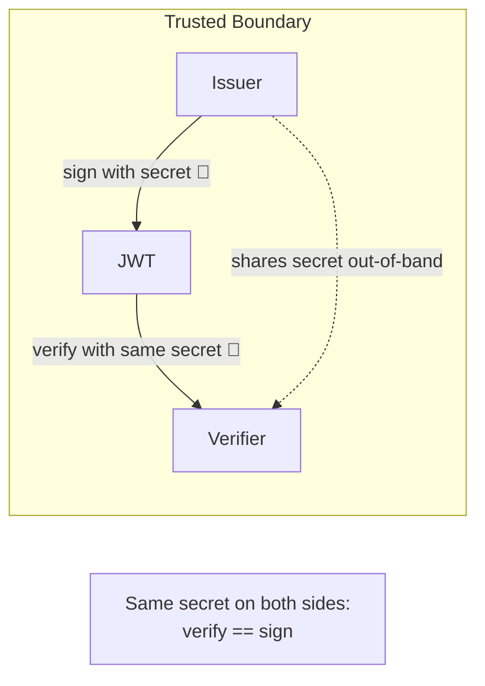

# 🔑 Module 05 — HMAC Algorithms (`HS256` / `HS384` / `HS512`)

> The shared-secret family. One key signs **and** verifies. Simple, fast, and
> perfect when the same party (or tightly trusted services) issues and checks
> tokens.

---

## 🧠 What is HMAC signing?

HMAC stands for **Hash-based Message Authentication Code**. For JWTs it works
like this:

```
signature = HMAC_SHA(secret, base64url(header) + "." + base64url(payload))
```

The number in the algorithm name is the SHA-2 hash used inside:

| Algorithm | Hash    | Digest / signature size |
|-----------|---------|-------------------------|
| `HS256`   | SHA-256 | 32 bytes (256 bits)     |
| `HS384`   | SHA-384 | 48 bytes (384 bits)     |
| `HS512`   | SHA-512 | 64 bytes (512 bits)     |

HMAC is **symmetric**: there is exactly one secret. Because verifying and
signing both need that same secret, **anyone who can verify can also forge**.
That is the defining trait — and limitation — of this family.

> 🔐 **Naming note:** `HS` = **H**MAC + **S**HA. `HS256` = HMAC using SHA-256.

---

## 🗺️ The shared-secret trust model



Both sides hold the **same** secret, exchanged ahead of time over a trusted
channel. Guard that secret like a password.

---

## 📜 Scripts in this module

| # | Script | What it shows | Run command |
|---|--------|---------------|-------------|
| 1 | [01_hs256.py](01_hs256.py) | Encode/decode with `HS256`; read the header `alg` | `.venv/bin/python pyjwt-course/05-hmac-algorithms/01_hs256.py` |
| 2 | [02_hs384.py](02_hs384.py) | Same round-trip with `HS384` | `.venv/bin/python pyjwt-course/05-hmac-algorithms/02_hs384.py` |
| 3 | [03_hs512.py](03_hs512.py) | Same round-trip with `HS512` | `.venv/bin/python pyjwt-course/05-hmac-algorithms/03_hs512.py` |
| 4 | [04_compare_signature_sizes.py](04_compare_signature_sizes.py) | Signature byte length per algorithm = digest size | `.venv/bin/python pyjwt-course/05-hmac-algorithms/04_compare_signature_sizes.py` |
| 5 | [05_shared_secret_model.py](05_shared_secret_model.py) | One secret signs *and* verifies; two simulated parties | `.venv/bin/python pyjwt-course/05-hmac-algorithms/05_shared_secret_model.py` |
| 6 | [06_secret_rotation_hmac.py](06_secret_rotation_hmac.py) | Accept multiple secrets during rotation via a candidate loop | `.venv/bin/python pyjwt-course/05-hmac-algorithms/06_secret_rotation_hmac.py` |

Run them all:

```bash
# from the repo root: /home/astro/catalyst/jwt-test
for f in pyjwt-course/05-hmac-algorithms/*.py; do .venv/bin/python "$f"; done
```

---

## ✨ Key takeaways

- **One secret, both directions.** With HMAC, *can verify == can sign*.
- **Bigger hash ⇒ bigger signature.** `HS256`→32B, `HS384`→48B, `HS512`→64B.
  `HS256` is a perfectly secure, common default.
- **Rotation = a list of accepted secrets.** Sign with the newest, verify
  against `[newest, …older]`, then drop the oldest once its tokens expire.

---

## ⚠️ Pitfalls

- 🚫 **Short/weak secrets.** RFC 7518 recommends a key at least as long as the
  hash output (≥32/48/64 bytes for HS256/384/512). PyJWT 2.13 emits an
  `InsecureKeyLengthWarning` for short keys — use long, random secrets.
- 🚫 **Sharing the secret too widely.** Every holder can mint valid tokens.
  If untrusted third parties must verify, you want **RSA** (Module 06), not HMAC.
- 🚫 **Algorithm mismatch.** You must list the *exact* algorithm in
  `algorithms=` (e.g. `["HS384"]`), and never accept `["none"]`.
- 🚫 **Hard-coding secrets in source.** Load from a secret manager / env var.

---

## ➡️ Next

When the same secret on both sides is no longer acceptable — because you need
others to verify but *not* sign — move on to
[Module 06 — RSA algorithms](../06-rsa-algorithms/).
