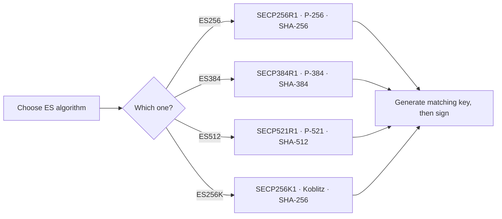

# 🟢 Module 07 · ECDSA Algorithms (ES256 / ES384 / ES512 / ES256K)

> Elliptic-curve signatures: **the same security as RSA, in a fraction of the
> size.** This module covers the entire ECDSA JWT family and the single most
> important rule that trips everyone up — *each algorithm is welded to one
> specific curve.*

---

## 🧠 What is ECDSA?

ECDSA (Elliptic Curve Digital Signature Algorithm) is an **asymmetric** signing
scheme. You sign with a **private** key and anyone can verify with the matching
**public** key — exactly like RSA. The difference is the underlying math:
elliptic curves instead of large-integer factorisation. The payoff is dramatic
size savings:

| Security level | RSA key | EC curve |
|----------------|---------|----------|
| ~112-bit | RSA-2048 | — |
| ~128-bit | RSA-3072 | **P-256** |
| ~192-bit | RSA-7680 | **P-384** |
| ~256-bit | RSA-15360 | **P-521** |

A 256-bit elliptic-curve key matches a 3072-bit RSA key. Smaller keys ⇒ smaller
signatures ⇒ smaller tokens ⇒ faster crypto.

---

## 🔗 The golden rule: algorithm ↔ curve

Every ECDSA JWT algorithm is bound to **exactly one** curve and **one** hash.
You cannot mix them.

| Algorithm | Curve (`cryptography` name) | NIST / common name | Hash |
|-----------|-----------------------------|--------------------|------|
| `ES256`  | `SECP256R1` | P-256 | SHA-256 |
| `ES384`  | `SECP384R1` | P-384 | SHA-384 |
| `ES512`  | `SECP521R1` | **P-521** ⚠️ | SHA-512 |
| `ES256K` | `SECP256K1` | secp256k1 (Bitcoin) | SHA-256 |



---

## 📜 Scripts in this module

| # | Script | What it teaches | Run command |
|---|--------|-----------------|-------------|
| 01 | [`01_generate_ec_keypair.py`](01_generate_ec_keypair.py) | Generate a P-256 keypair, serialise to PEM | `.venv/bin/python pyjwt-course/07-ecdsa-algorithms/01_generate_ec_keypair.py` |
| 02 | [`02_es256.py`](02_es256.py) | Sign/verify with **ES256** (P-256) | `.venv/bin/python pyjwt-course/07-ecdsa-algorithms/02_es256.py` |
| 03 | [`03_es384.py`](03_es384.py) | Sign/verify with **ES384** (P-384) | `.venv/bin/python pyjwt-course/07-ecdsa-algorithms/03_es384.py` |
| 04 | [`04_es512.py`](04_es512.py) | Sign/verify with **ES512** (P-**521**!) | `.venv/bin/python pyjwt-course/07-ecdsa-algorithms/04_es512.py` |
| 05 | [`05_es256k.py`](05_es256k.py) | Sign/verify with **ES256K** (Bitcoin curve) | `.venv/bin/python pyjwt-course/07-ecdsa-algorithms/05_es256k.py` |
| 06 | [`06_curve_must_match_alg.py`](06_curve_must_match_alg.py) | Prove a P-256 key fails with ES384 | `.venv/bin/python pyjwt-course/07-ecdsa-algorithms/06_curve_must_match_alg.py` |
| 07 | [`07_ecdsa_vs_rsa_size.py`](07_ecdsa_vs_rsa_size.py) | Measure EC vs RSA key & signature sizes | `.venv/bin/python pyjwt-course/07-ecdsa-algorithms/07_ecdsa_vs_rsa_size.py` |

Run them all:

```bash
for f in pyjwt-course/07-ecdsa-algorithms/0*.py; do .venv/bin/python "$f"; done
```

---

## ⚠️ Pitfalls

- **ES512 uses P-521, not "P-512".** There is no SECP512R1 curve. The `512`
  refers to **SHA-512**; the curve is the 521-bit `SECP521R1`. This is the most
  common ECDSA beginner trap.
- **Wrong curve = hard failure.** Signing with a key whose curve doesn't match
  the algorithm raises `InvalidKeyError` (see script 06).
- **ES256 ≠ ES256K.** Both are 256-bit + SHA-256, but they use *different*
  curves (NIST P-256 vs Koblitz secp256k1). They are not interchangeable.
- **ECDSA needs a good RNG at sign time.** A repeated/predictable nonce can leak
  the private key. (EdDSA — Module 09 — fixes this by being deterministic.)
- **Always pin `algorithms=[...]`** in `jwt.decode()`. Never accept an open list.

---

## 🔑 Key takeaways

- ECDSA gives **RSA-grade security with much smaller keys, signatures, and
  tokens**.
- Each `ES*` algorithm is locked to one curve + one hash — memorise the table.
- `ES256K` is the blockchain/DID curve (Bitcoin & Ethereum).
- PyJWT happily accepts PEM bytes/str **or** `cryptography` key objects for both
  signing and verifying.

➡️ **Next:** [Module 08 · RSA-PSS](../08-rsa-pss-algorithms/) — modern,
probabilistic RSA signatures.
