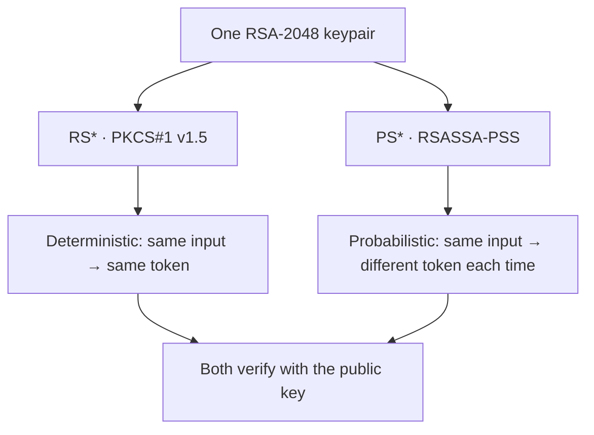

# 🔵 Module 08 · RSA-PSS Algorithms (PS256 / PS384 / PS512)

> Same RSA keys you already know — but with **modern, probabilistic padding**.
> Meet the `PS*` family: the cryptographically preferred way to do RSA
> signatures in JWTs.

---

## 🧠 PSS vs PKCS#1 v1.5 — the one idea that matters

RSA signing has **two** padding schemes, and the JWT algorithm name tells you
which one is in play:

| Family | Padding scheme | Behaviour | Status |
|--------|----------------|-----------|--------|
| `RS256/384/512` | PKCS#1 v1.5 (1993) | **Deterministic** | Legacy, ubiquitous |
| `PS256/384/512` | **RSASSA-PSS** | **Probabilistic** (random salt) | Modern, recommended |

Both use the **same RSA keypair**. The only difference is the encoding/padding
step inside the signature. PSS has a stronger security proof and injects a
random salt on every signature, which is why it's the recommendation for new
systems.



| Algorithm | Padding | Hash | Min key |
|-----------|---------|------|---------|
| `PS256` | RSASSA-PSS | SHA-256 | RSA-2048 |
| `PS384` | RSASSA-PSS | SHA-384 | RSA-2048 |
| `PS512` | RSASSA-PSS | SHA-512 | RSA-2048 |

> 🔁 Unlike ECDSA, the **hash is independent of the key size** — one RSA key can
> produce PS256, PS384 and PS512 signatures.

---

## 📜 Scripts in this module

| # | Script | What it teaches | Run command |
|---|--------|-----------------|-------------|
| 01 | [`01_ps256.py`](01_ps256.py) | Generate RSA-2048, sign/verify with **PS256** | `.venv/bin/python pyjwt-course/08-rsa-pss-algorithms/01_ps256.py` |
| 02 | [`02_ps384_ps512.py`](02_ps384_ps512.py) | One key → **PS384** and **PS512** | `.venv/bin/python pyjwt-course/08-rsa-pss-algorithms/02_ps384_ps512.py` |
| 03 | [`03_pss_is_probabilistic.py`](03_pss_is_probabilistic.py) | PS256 tokens differ; RS256 tokens identical | `.venv/bin/python pyjwt-course/08-rsa-pss-algorithms/03_pss_is_probabilistic.py` |
| 04 | [`04_pss_vs_pkcs1.py`](04_pss_vs_pkcs1.py) | Side-by-side PS* vs RS* explanation + demo | `.venv/bin/python pyjwt-course/08-rsa-pss-algorithms/04_pss_vs_pkcs1.py` |
| 05 | [`05_same_key_both_schemes.py`](05_same_key_both_schemes.py) | One key, both schemes; PS256 ≠ RS256 at verify | `.venv/bin/python pyjwt-course/08-rsa-pss-algorithms/05_same_key_both_schemes.py` |

Run them all:

```bash
for f in pyjwt-course/08-rsa-pss-algorithms/0*.py; do .venv/bin/python "$f"; done
```

---

## 🔬 The probabilistic demo (script 03)

Sign the **identical** payload twice:

```
PS256 → token A ≠ token B   (random salt each time)
RS256 → token A = token B   (deterministic)
```

Both PS256 tokens still verify perfectly. The randomness is a **feature**, not
corruption — it's what makes PSS provably secure.

---

## ⚠️ Pitfalls

- **The verifier's `algorithms=[...]` is a security boundary.** A PS256 token
  will **not** verify if you only allow `["RS256"]` — even with the same key —
  raising `InvalidAlgorithmError` (script 05). Pin the algorithms you expect.
- **Don't assume tokens are stable.** If you cache or deduplicate by token
  string, remember PS* tokens change every signing call.
- **RSA-2048 is the floor.** Use 2048-bit minimum; 3072-bit for higher
  assurance.
- **PS* ⊄ RS* interop.** Older verifiers may not understand PSS — keep RS256 for
  legacy interoperability, choose PS* for new designs.

---

## 🔑 Key takeaways

- `PS*` = RSA + **RSASSA-PSS** padding; `RS*` = RSA + **PKCS#1 v1.5** padding.
- PSS is **probabilistic** (random salt) → identical inputs yield different
  tokens; PKCS#1 v1.5 is **deterministic**.
- The **same RSA keypair** works for both families and all three hash sizes.
- Prefer **PS256/384/512 for new systems**; keep RS* only for compatibility.

➡️ **Next:** [Module 09 · EdDSA](../09-eddsa-algorithms/) — the modern,
deterministic, misuse-resistant default.
