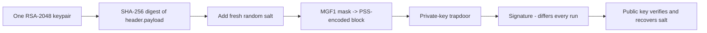

## 🧠 Mental Model — Behind the Scenes

RSA-PSS uses the **exact same RSA key pair and the same trapdoor** as Module 06 — the only thing that changes is the **padding** applied to the hash before the private-key transform. Where `RS*` uses the rigid, deterministic PKCS#1 v1.5 template, `PS*` uses **RSASSA-PSS** (Probabilistic Signature Scheme). PSS folds in a freshly generated **random salt** on every signature, runs it through a mask-generation function (MGF1) to spread the bits across the whole padded block, and only then applies the trapdoor. That single design choice has a stronger, cleaner security proof — which is why PSS is the *recommended* padding for new RSA signatures.

The headline behavioural consequence is that **PSS is probabilistic**. Sign the identical payload twice with the identical key and you get **two different tokens**, because each one carries a different random salt baked into its signature. This feels alarming the first time you see it, but both tokens verify perfectly — the salt is recovered and checked as part of verification. Contrast this with `RS256`, which is deterministic: same input, byte-for-byte identical token every time.

Because only the padding differs, **one RSA-2048 key pair serves every variant**: `RS256/384/512` *and* `PS256/384/512`, all three hash sizes, from the same key. The hash is independent of the key size (unlike ECDSA, where the algorithm fixes the curve). But the algorithm string is still a hard security boundary at verification time: a `PS256` token will **not** validate if your verifier only allows `["RS256"]`, even with the correct key — PyJWT raises `InvalidAlgorithmError`. The padding scheme is part of the contract, so you must pin the exact algorithms you expect.

### 🔍 A concrete analogy

It's like signing a contract with **invisible-ink confetti sprinkled on top each time**. The signature underneath is yours, but the random sparkle pattern is different on every copy. A verifier holding your reference card can still confirm the signature is genuine *and* that the confetti was applied correctly — yet no two signed copies ever look identical, which makes certain forgery and replay tricks far harder.

### ⚙️ What actually happens when you run the code

1. `rsa.generate_private_key(...)` creates one ordinary RSA-2048 key pair — nothing PSS-specific yet.
2. `jwt.encode(payload, private_pem, algorithm="PS256")` SHA-256-hashes the signing input.
3. PSS generates a **random salt**, runs MGF1 to build the padded block, and applies the private-key trapdoor — producing signature *A*.
4. Calling `jwt.encode` again with the same payload draws a **new** salt, producing signature *B* ≠ *A*.
5. `jwt.decode(..., algorithms=["PS256"])` uses the public key to undo the trapdoor, recovers the salt, and confirms the PSS encoding is valid for the recomputed digest.
6. Both *A* and *B* verify; the same key also produces valid `RS256` tokens, which *are* identical run-to-run.

### 👀 What to notice when you run the examples

- In `03_pss_is_probabilistic.py`, two `PS256` calls print **"Tokens identical? False"** while two `RS256` calls print **"True"** — the probabilistic-vs-deterministic split, live.
- Both differing PS256 tokens still pass `jwt.decode` — randomness is a *feature*, not corruption.
- In `05_same_key_both_schemes.py`, the **same key** signs both PS256 and RS256; mixing them at verify time raises `InvalidAlgorithmError`.
- In `02_ps384_ps512.py`, one RSA key yields PS384 and PS512 — the hash is free to vary without touching the key.

### ⚠️ Common misconceptions

- **"PS* needs a special RSA key."** No — it's the same key as RS*. Only the padding inside the signature differs.
- **"A changing token means something is broken."** PSS *intends* to change every time. Don't cache or deduplicate by token string.
- **"If the key matches, any RSA algorithm verifies."** The `algorithms=[...]` whitelist is enforced; PS256 ≠ RS256 even with one key.
- **"Probabilistic means less reliable."** The randomness strengthens the security proof; verification remains deterministic and exact.
