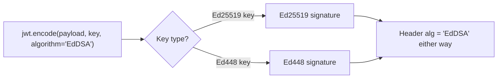

# 🟣 Module 09 · EdDSA Algorithms (Ed25519 / Ed448)

> The modern default. **Tiny keys, blazing speed, deterministic by design, and
> hard to misuse.** If you're choosing a signature scheme for a new system in
> 2025+, this is usually the right answer.

---

## 🧠 What is EdDSA?

EdDSA (Edwards-curve Digital Signature Algorithm) is an elliptic-curve scheme
built on **twisted Edwards curves**. It comes in two flavours:

| Flavour | Curve | Security | Public key | Signature |
|---------|-------|----------|------------|-----------|
| **Ed25519** | Curve25519 | ~128-bit | **32 bytes** | 64 bytes |
| **Ed448** | Curve448 | ~224-bit | 57 bytes | 114 bytes |

### ⚠️ One algorithm string for both: `"EdDSA"`

This is the EdDSA gotcha. In JWT, **both** Ed25519 and Ed448 use the **same**
JOSE header value:

```json
{ "alg": "EdDSA", "typ": "JWT" }
```

There is no `"Ed25519"` or `"Ed448"` alg value. The **key type itself** (the
curve baked into the key object) determines which curve is used. You always pass
`algorithm="EdDSA"` to `jwt.encode()`.



---

## ✨ Why EdDSA wins

- **Deterministic.** No random nonce at signing time — signing the same message
  twice gives the *identical* signature. This kills an entire class of ECDSA
  disasters where a bad/repeated nonce leaks the private key (e.g. the Sony PS3
  break).
- **Fast.** No big-integer math, no modular inversion — among the fastest schemes
  to both sign and verify.
- **Tiny.** A 32-byte Ed25519 public key vs a 256-byte RSA-2048 modulus.
- **Misuse-resistant.** The curve and parameters are fixed; far fewer footguns.

| Property | ECDSA (`ES*`) | EdDSA |
|----------|---------------|-------|
| RNG at sign time | **Required** | Not needed |
| Misuse risk | Bad nonce → key leak | Resistant by design |
| Curve selection | Algorithm fixes curve | Key type fixes curve |
| JWT `alg` value | `ES256`/`ES384`/`ES512`/`ES256K` | `EdDSA` (both) |
| Determinism | No | **Yes** |

---

## 📜 Scripts in this module

| # | Script | What it teaches | Run command |
|---|--------|-----------------|-------------|
| 01 | [`01_ed25519_sign_verify.py`](01_ed25519_sign_verify.py) | Generate Ed25519, sign/verify (`alg=EdDSA`) | `.venv/bin/python pyjwt-course/09-eddsa-algorithms/01_ed25519_sign_verify.py` |
| 02 | [`02_ed448_sign_verify.py`](02_ed448_sign_verify.py) | Generate Ed448, sign/verify (`alg=EdDSA`) | `.venv/bin/python pyjwt-course/09-eddsa-algorithms/02_ed448_sign_verify.py` |
| 03 | [`03_eddsa_is_deterministic.py`](03_eddsa_is_deterministic.py) | Same payload twice → identical tokens | `.venv/bin/python pyjwt-course/09-eddsa-algorithms/03_eddsa_is_deterministic.py` |
| 04 | [`04_eddsa_key_sizes.py`](04_eddsa_key_sizes.py) | 32-byte raw key; vs EC & RSA PEM sizes | `.venv/bin/python pyjwt-course/09-eddsa-algorithms/04_eddsa_key_sizes.py` |
| 05 | [`05_eddsa_vs_ecdsa.py`](05_eddsa_vs_ecdsa.py) | EdDSA vs ECDSA, working side-by-side demo | `.venv/bin/python pyjwt-course/09-eddsa-algorithms/05_eddsa_vs_ecdsa.py` |

Run them all:

```bash
for f in pyjwt-course/09-eddsa-algorithms/0*.py; do .venv/bin/python "$f"; done
```

---

## ⚠️ Pitfalls

- **Don't look for an `"Ed25519"` alg.** The header always says `"EdDSA"`; the
  curve is implied by the key. Passing `algorithm="Ed25519"` will fail.
- **Pin `algorithms=["EdDSA"]`** at decode time like every other scheme.
- **Ed448 ≠ Ed25519 keys.** A token signed with an Ed25519 key must be verified
  with the matching Ed25519 public key (and vice versa for Ed448).
- **Determinism is intended.** Identical tokens for identical input is correct
  behaviour, not a bug — don't "fix" it.

---

## 🔑 Key takeaways

- EdDSA = **deterministic, fast, tiny-keyed, misuse-resistant** signatures.
- **One alg string, `"EdDSA"`**, covers both Ed25519 and Ed448; the key picks
  the curve.
- It removes ECDSA's dangerous dependence on a per-signature secure RNG.
- For most **new** services, EdDSA (Ed25519) is the recommended default.

➡️ **Back to:** [Course curriculum map](../README.md)
