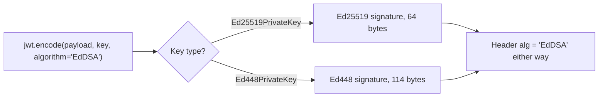

## 🧠 Mental Model — Behind the Scenes

EdDSA is built on **twisted Edwards curves** — a reformulation of elliptic curves whose addition formula is *complete* (it works for every pair of points with no awkward special cases). That mathematical tidiness is what makes EdDSA so hard to misuse: there are far fewer edge cases where an implementation can leak secrets. The two flavours are **Ed25519** (Curve25519, ~128-bit security, a tiny **32-byte** public key, 64-byte signature) and **Ed448** (Curve448, ~224-bit security, 57-byte key, 114-byte signature). Both are fast because they avoid the big-integer modular inversions that slow RSA and classic ECDSA.

The defining trick is **deterministic nonces**. Recall ECDSA's fatal dependence on a fresh random `k` per signature (Module 07) — reuse it and your private key spills out. EdDSA eliminates that risk entirely: instead of drawing `k` from a random number generator, it **derives `k` by hashing the private key together with the message**. No RNG is consulted at signing time. Sign the same message twice and you get the **byte-for-byte identical signature** — and crucially, two *different* messages can never accidentally collide on the same nonce. An entire category of catastrophic real-world failures (the Sony PS3 break, various wallet key leaks) simply cannot happen.

In the JWT world there's one quirk to internalize: **both flavours share a single `alg` value, `"EdDSA"`**. There is no `"Ed25519"` or `"Ed448"` algorithm string in the JOSE header. You always pass `algorithm="EdDSA"` to `jwt.encode`, and the **key object itself** — whether it's an `Ed25519PrivateKey` or an `Ed448PrivateKey` — silently determines which curve is used. The curve is a property of the key, not the header.

### 🔍 A concrete analogy

Think of a **tamper-evident notary stamp whose ink is mixed from the document's own text**. Because the ink recipe is computed deterministically from what's being stamped, the same document always produces the same imprint — and there's no separate ink bottle (random nonce) that could be refilled wrong, run dry, or get reused on the next document. One predictable, self-contained process, every time.

### ⚙️ What actually happens when you run the code

1. `Ed25519PrivateKey.generate()` produces a compact 32-byte secret scalar and its 32-byte public point.
2. The keys serialize to PEM (PKCS#8 / SubjectPublicKeyInfo) so PyJWT can take the bytes directly.
3. `jwt.encode(payload, private_pem, algorithm="EdDSA")` hashes the **private key + message** to derive the nonce deterministically — no RNG involved.
4. It computes the signature and stamps `{"alg": "EdDSA", "typ": "JWT"}` into the header — note the curve is *not* recorded there.
5. Signing the identical payload again derives the **same** nonce, yielding an identical token, byte-for-byte.
6. `jwt.decode(token, public_pem, algorithms=["EdDSA"])` verifies against the public point and returns the claims.

### 👀 What to notice when you run the examples

- In `03_eddsa_is_deterministic.py`, two signings print **"Tokens identical? True"** — the opposite of Module 08's PSS, and no RNG was touched.
- In `01_ed25519_sign_verify.py`, the JOSE header reads `"alg": "EdDSA"` — never `"Ed25519"`, even though the key is Ed25519.
- In `04_eddsa_key_sizes.py`, the raw Ed25519 public key is just **32 bytes** — a fraction of RSA-2048's 256-byte modulus.
- In `05_eddsa_vs_ecdsa.py`, EdDSA and ECDSA sit side by side: EdDSA needs no sign-time randomness, ECDSA does.

### ⚠️ Common misconceptions

- **"The alg should be `Ed25519`."** It's always `"EdDSA"`; passing `algorithm="Ed25519"` fails. The key picks the curve.
- **"Deterministic signatures are insecure."** The opposite — determinism removes ECDSA's nonce-reuse vulnerability entirely.
- **"Identical tokens for identical input is a bug."** It's correct, intended behaviour — don't try to "fix" it.
- **"You still need `algorithms=[...]` only for RSA/ECDSA."** Pin `algorithms=["EdDSA"]` at decode time too — the whitelist matters for every scheme.
