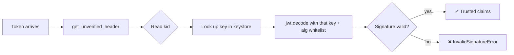

# 🪪 Module 10 · Headers & `kid`

> The **payload** gets all the attention, but the tiny JSON object at the *front*
> of every JWT — the **JOSE header** — is what makes multi-key systems, key
> rotation, and JWKS possible. This module is all about that header.

---

## 🧠 The big idea

A JWT is `header.payload.signature`. The header answers a single question for the
verifier: **"how do I process this token?"** Two parameters carry most of the
weight:

- **`alg`** — *which algorithm* signed it (`HS256`, `RS256`, …).
- **`kid`** — *which key* signed it, so the verifier can pick the right one from
  a set of many.

Once a service has more than one signing key (which every real service
eventually does), `kid` stops being optional trivia and becomes the linchpin of
verification. The pattern you learn here — *read `kid` from the unverified
header, look up the key, then verify* — is **exactly** how JWKS works in
module 11.

---

## 🔄 How header-driven key selection works



The key insight: you **must** read the header *before* you can verify, because
the header tells you which key to verify *with*. That read is unverified — so you
use it only to **select a key**, never to make a trust decision.

---

## 📜 Scripts in this module

| # | Script | What it teaches |
|---|--------|-----------------|
| 01 | [`01_default_header.py`](01_default_header.py) | The default header `{"alg":"HS256","typ":"JWT"}` via `get_unverified_header` |
| 02 | [`02_custom_headers.py`](02_custom_headers.py) | Adding `kid`, `cty`, and custom params with `headers=` |
| 03 | [`03_kid_key_id.py`](03_kid_key_id.py) | Selecting the right secret from a `{kid: key}` keystore |
| 04 | [`04_get_unverified_header.py`](04_get_unverified_header.py) | Reading `alg`/`kid` **before** verifying — and why it's UNTRUSTED |
| 05 | [`05_typ_and_cty.py`](05_typ_and_cty.py) | `typ` (envelope type, e.g. `at+jwt`) vs. `cty` (payload type) |
| 06 | [`06_header_drives_key_selection.py`](06_header_drives_key_selection.py) | The full `kid → key → decode` pattern — the foundation of JWKS |

### ▶️ Run them

```bash
# from the repo root: /home/astro/catalyst/jwt-test
.venv/bin/python pyjwt-course/10-headers-and-kid/01_default_header.py
.venv/bin/python pyjwt-course/10-headers-and-kid/02_custom_headers.py
.venv/bin/python pyjwt-course/10-headers-and-kid/03_kid_key_id.py
.venv/bin/python pyjwt-course/10-headers-and-kid/04_get_unverified_header.py
.venv/bin/python pyjwt-course/10-headers-and-kid/05_typ_and_cty.py
.venv/bin/python pyjwt-course/10-headers-and-kid/06_header_drives_key_selection.py
```

---

## 🗝️ Common header parameters

| Param | Meaning | Example |
|-------|---------|---------|
| `alg` | Signing algorithm (PyJWT sets this for you) | `HS256`, `RS256` |
| `typ` | Media type of the **token** | `JWT`, `at+jwt` |
| `cty` | Media type of the **payload** | `JWT` (nested), `application/json` |
| `kid` | Key identifier for verification-key lookup | `key-1`, `2025-key` |

---

## ✅ Key takeaways

- `jwt.encode(..., headers={...})` adds custom header params; PyJWT always
  supplies `alg` itself, so don't put `alg` in `headers=`.
- `jwt.get_unverified_header(token)` decodes the header **without** the key and
  **without** checking the signature — use it purely to choose a verification key.
- `kid` lets one verifier hold many keys and pick the correct one per token.
- `typ` describes the envelope (use explicit types like `at+jwt` defensively);
  `cty` describes the payload (mainly for nested JWTs).
- The `kid → key → decode` flow is the conceptual core of JWKS (module 11).

## ⚠️ Pitfalls

- **Trusting unverified data.** The header (and unverified payload) are
  attacker-controlled. Only use them to *select a key*, never to authorize.
- **Echoing `alg` back into `decode`.** Always pass a fixed, trusted
  `algorithms=[...]` whitelist. Feeding the token's own `alg` into `decode`
  enables algorithm-confusion attacks (module 14).
- **Forgetting `kid` exists until rotation.** Add `kid` from day one; retrofitting
  it during an incident is painful.
- **Assuming a missing `kid` is fine.** Decide explicitly how to handle tokens
  with no `kid` (reject, or fall back to a default key).
