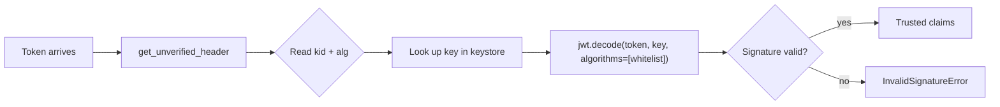

## 🧠 Mental Model — Behind the Scenes

A JWT is three base64url segments — `header.payload.signature` — and the **first** one, the **JOSE header**, is the verifier's instruction sheet. It's a small JSON object that answers, *"how do I process this token before I trust anything in it?"* The two parameters that carry the weight are **`alg`** (which algorithm signed it — `HS256`, `RS256`, …) and **`kid`** (a *key identifier* string naming *which* key signed it). Other parameters you'll meet are `typ` (the media type of the whole token, e.g. `JWT` or `at+jwt`) and `cty` (the media type of the *payload*, used mainly for nested JWTs).

Here's the subtle, important part: to verify a token you need to know which key to verify *with* — but that information lives in the header, which you haven't verified yet. So there's an unavoidable bootstrap step. `jwt.get_unverified_header(token)` simply **base64url-decodes the first segment** without touching the signature or any key. That gives you `alg` and `kid` *before* verification. You then use `kid` to look up the right key in your keystore, and *only then* call `jwt.decode` to do the real, signature-checked validation. The golden rule: the unverified header is **attacker-controlled data**, safe to use only for **key selection**, never for an authorization or trust decision.

This `kid → look up key → verify` pattern is the entire conceptual foundation of **JWKS** (Module 11). A real identity provider holds *many* keys at once — for rotation, for multiple environments — and publishes their public halves as a JWKS document. The verifier reads `kid` from each incoming token, finds the matching key in its cached copy of that document, and verifies. Swap the in-memory `{kid: key}` dict in this module's scripts for "a JSON document fetched over HTTPS and cached," and you've literally built what `PyJWKClient` does. The mechanics are identical — only the *source* of the keys changes.

### 🔍 A concrete analogy

The header is the **address and routing line on an envelope**. The postal sorter reads "destination: branch 5" *before* opening anything, and uses it only to route the letter to the right desk — never as proof the letter is genuine. The `kid` is that routing label: it tells the verifier which key (which "desk") should examine the contents, but the contents aren't trusted until the signature inside is actually checked.

### ⚙️ What actually happens when you run the code

1. The issuer keeps a keystore — a `{kid: key}` map of several active keys.
2. When signing, it picks one key and stamps that key's `kid` into the header via `headers={"kid": kid}`; PyJWT adds `alg` automatically.
3. A token arrives at the verifier; `jwt.get_unverified_header(token)` base64url-decodes the first segment — **no signature check, no key needed**.
4. The verifier reads `kid` and looks it up in its own keystore; an unknown `kid` is rejected immediately (`InvalidKeyError`).
5. With the resolved key, `jwt.decode(token, key, algorithms=ALLOWED_ALGS)` performs the full, signature-checked validation against a **fixed** algorithm whitelist.
6. A valid signature returns the claims; tampering or a wrong key raises `InvalidSignatureError`.

### 👀 What to notice when you run the examples

- In `01_default_header.py`, the header is `{"alg":"HS256","typ":"JWT"}` even though you never set `typ` or `alg` — PyJWT supplies them.
- In `04_get_unverified_header.py`, you read `alg`/`kid` with **no key at all** — a vivid reminder the header is unauthenticated.
- In `06_header_drives_key_selection.py`, two tokens signed under different `kid`s each route to the correct secret and verify cleanly.
- In that same script, a token with `kid: "ghost"` is rejected with `InvalidKeyError` *before* any signature math runs — selection fails fast.
- In `05_typ_and_cty.py`, notice `typ` describes the *envelope* (`at+jwt`) while `cty` describes the *payload* (nested JWTs).

### ⚠️ Common misconceptions

- **"The header is verified, so I can trust `kid`/`alg`."** It is **not** verified by `get_unverified_header`. Use it only to *select* a key.
- **"Just pass the token's own `alg` into `decode`."** That enables algorithm-confusion attacks (Module 14). Always pin a fixed `algorithms=[...]` whitelist.
- **"`kid` is optional trivia."** The moment you have more than one key, `kid` is the linchpin of verification — add it from day one.
- **"`typ` and `cty` are the same thing."** `typ` is the token's media type; `cty` is the *payload's* media type, used chiefly for nested JWTs.
