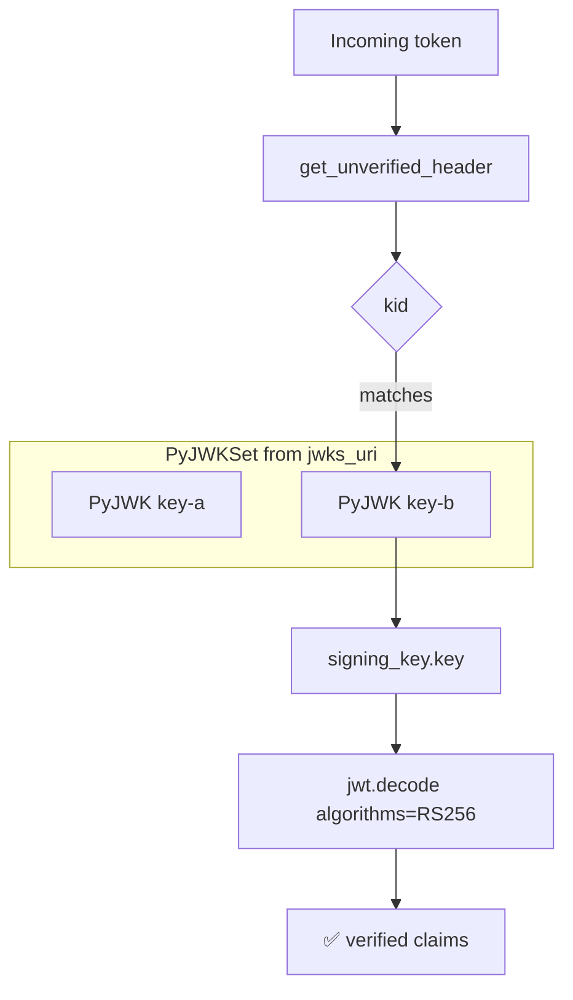
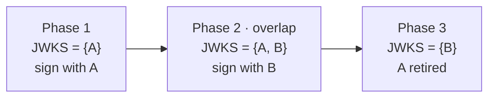

# 🔑 Module 11 · JWKS & Key Rotation

> How does Google verify a token *you've* never sent it before, signed with a key
> it rotated last week? The answer is **JWKS** — a published set of public keys,
> addressable by `kid`. This module builds the whole machine locally, no network
> required.

---

## 🧠 The big idea

Asymmetric tokens (RS256, ES256, …) are verified with a **public** key. Providers
need a standard, web-friendly way to *publish* those public keys so any client
can verify tokens. That standard is:

- **JWK** (JSON Web Key) — one key, expressed as JSON (`kty`, `n`, `e`, `kid`, …).
- **JWKS** (JSON Web Key *Set*) — `{"keys": [jwk, jwk, …]}`, served at a
  `jwks_uri`.
- **`PyJWKSet` / `PyJWKClient`** — PyJWT's tools to load a JWKS and pick the right
  key for a token by its `kid`.

Because a set can hold **many** keys at once, providers can rotate keys with zero
downtime: publish old + new together, switch signing to the new key, then drop
the old one once its tokens have expired.

---

## 🔄 JWKS verification flow



`PyJWKClient` is just this flow plus **"fetch the JWKS over HTTPS and cache it."**

---

## 🔁 Key rotation timeline



During Phase 2, **both** old (A-signed) and new (B-signed) tokens verify. Only
when A is dropped in Phase 3 do lingering A-tokens finally fail.

---

## 📜 Scripts in this module

| # | Script | What it teaches |
|---|--------|-----------------|
| 01 | [`01_what_is_a_jwk.py`](01_what_is_a_jwk.py) | What a JWK is; build one with `RSAAlgorithm.to_jwk` |
| 02 | [`02_jwk_from_rsa_key.py`](02_jwk_from_rsa_key.py) | Round-trip a key: `to_jwk` → `from_jwk`, then verify |
| 03 | [`03_build_a_jwks.py`](03_build_a_jwks.py) | Assemble a `{"keys": [...]}` JWKS from two RSA keys |
| 04 | [`04_pyjwkset_from_dict.py`](04_pyjwkset_from_dict.py) | Load a JWKS with `PyJWKSet.from_dict`; access keys by `kid` |
| 05 | [`05_select_key_by_kid.py`](05_select_key_by_kid.py) | `kid` → matching `PyJWK` → verify |
| 06 | [`06_key_rotation_flow.py`](06_key_rotation_flow.py) | Full rotation simulation across three phases |
| 07 | [`07_pyjwkclient_explained.py`](07_pyjwkclient_explained.py) | What `PyJWKClient` does, reproduced manually (+ real snippet) |

### ▶️ Run them

```bash
# from the repo root: /home/astro/catalyst/jwt-test
.venv/bin/python pyjwt-course/11-jwks-and-key-rotation/01_what_is_a_jwk.py
.venv/bin/python pyjwt-course/11-jwks-and-key-rotation/02_jwk_from_rsa_key.py
.venv/bin/python pyjwt-course/11-jwks-and-key-rotation/03_build_a_jwks.py
.venv/bin/python pyjwt-course/11-jwks-and-key-rotation/04_pyjwkset_from_dict.py
.venv/bin/python pyjwt-course/11-jwks-and-key-rotation/05_select_key_by_kid.py
.venv/bin/python pyjwt-course/11-jwks-and-key-rotation/06_key_rotation_flow.py
.venv/bin/python pyjwt-course/11-jwks-and-key-rotation/07_pyjwkclient_explained.py
```

---

## 🧩 The key PyJWT APIs

| API | Purpose |
|-----|---------|
| `jwt.algorithms.RSAAlgorithm.to_jwk(public_key)` | Key object → JWK JSON string |
| `jwt.algorithms.RSAAlgorithm.from_jwk(jwk_json)` | JWK JSON → key object |
| `jwt.PyJWKSet.from_dict(jwks)` | JWKS dict → set of `PyJWK` objects |
| `jwks_set[kid]` / `jwks_set.keys` | Select a `PyJWK` by `kid` / iterate all |
| `PyJWK.key` | The ready-to-use verification key for `jwt.decode` |
| `PyJWKClient(uri).get_signing_key_from_jwt(token)` | Fetch+cache JWKS, return signing key (network) |

---

## ✅ Key takeaways

- A **JWK** is a key as JSON; a **JWKS** is a list of JWKs under `"keys"`.
- `kid` ties a token to a specific key in the set — rotation depends on it.
- `PyJWKSet.from_dict` + `jwks_set[kid].key` is the manual JWKS verification path.
- `PyJWKClient` adds HTTPS fetching and caching on top of that exact path.
- Rotate by **overlapping** keys, then dropping the old one after its tokens age
  out.

## ⚠️ Pitfalls

- **No `kid` in the token (or the set).** If the token's `kid` isn't published,
  verification must fail — handle the lookup miss explicitly.
- **Caching too aggressively.** If you cache a JWKS forever, you'll reject tokens
  signed by a freshly rotated key. `PyJWKClient` caches with sane defaults;
  respect rotation.
- **Re-fetching on every request.** The opposite mistake — hammering the
  `jwks_uri`. Cache it.
- **Trusting the JWKS source.** Always fetch over HTTPS from the provider's
  well-known URL; a poisoned JWKS means forged tokens.
- **Forgetting the algorithm whitelist.** Even with the right key, always pass
  `algorithms=["RS256"]` (or your expected set) to `jwt.decode`.
