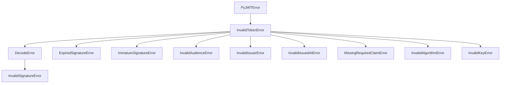
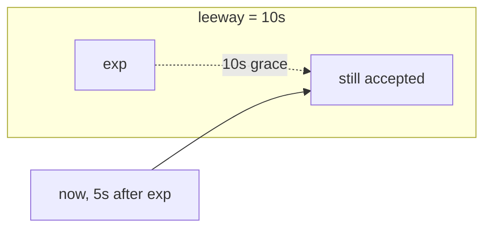

# 🚦 Module 12 · Validation, Errors & Leeway

> A token either verifies or it doesn't — but *why* it failed is the difference
> between a helpful `401` and a baffled user. This module maps PyJWT's exception
> hierarchy, triggers each failure on purpose, and builds a production-grade
> validator that never crashes.

---

## 🧠 The big idea

`jwt.decode` does a *lot* of checking: structure, signature, `exp`, `nbf`, `aud`,
`iss`, required claims. Each distinct failure raises a **specific** exception, and
those exceptions form an inheritance tree rooted at `PyJWTError`. Master the tree
and you can:

- **Catch broadly** — `except InvalidTokenError` to reject any bad token.
- **Catch narrowly** — `except ExpiredSignatureError` to offer a refresh.
- **Tolerate clock skew** — `leeway=` for tokens that are *just* expired/early.

---

## 🌳 The exception hierarchy



> **Order your `except` blocks most-specific first.** Because
> `InvalidSignatureError` *is a* `DecodeError` *is an* `InvalidTokenError`, a
> broad catch placed too early will swallow the specific cases.

---

## 📜 Scripts in this module

| # | Script | Triggers / teaches |
|---|--------|--------------------|
| 01 | [`01_exception_hierarchy.py`](01_exception_hierarchy.py) | Prints the class tree via `inspect` MRO |
| 02 | [`02_expired_signature_error.py`](02_expired_signature_error.py) | `exp` in the past → `ExpiredSignatureError` |
| 03 | [`03_invalid_signature_error.py`](03_invalid_signature_error.py) | Wrong key → `InvalidSignatureError` |
| 04 | [`04_decode_error.py`](04_decode_error.py) | Malformed token → `DecodeError` |
| 05 | [`05_invalid_audience_error.py`](05_invalid_audience_error.py) | `aud` mismatch → `InvalidAudienceError` |
| 06 | [`06_immature_signature_error.py`](06_immature_signature_error.py) | `nbf` in the future → `ImmatureSignatureError` |
| 07 | [`07_leeway.py`](07_leeway.py) | `leeway=` accepts a just-expired token |
| 08 | [`08_robust_validator.py`](08_robust_validator.py) | A reusable `validate()` mapping errors → friendly reasons + HTTP status |

### ▶️ Run them

```bash
# from the repo root: /home/astro/catalyst/jwt-test
.venv/bin/python pyjwt-course/12-validation-errors-and-leeway/01_exception_hierarchy.py
.venv/bin/python pyjwt-course/12-validation-errors-and-leeway/02_expired_signature_error.py
.venv/bin/python pyjwt-course/12-validation-errors-and-leeway/03_invalid_signature_error.py
.venv/bin/python pyjwt-course/12-validation-errors-and-leeway/04_decode_error.py
.venv/bin/python pyjwt-course/12-validation-errors-and-leeway/05_invalid_audience_error.py
.venv/bin/python pyjwt-course/12-validation-errors-and-leeway/06_immature_signature_error.py
.venv/bin/python pyjwt-course/12-validation-errors-and-leeway/07_leeway.py
.venv/bin/python pyjwt-course/12-validation-errors-and-leeway/08_robust_validator.py
```

---

## 🗂️ Error → meaning → response

| Exception | Cause | Typical HTTP status |
|-----------|-------|---------------------|
| `DecodeError` | Not a structurally valid JWT | `400 Bad Request` |
| `InvalidSignatureError` | Wrong key / tampered token | `401 Unauthorized` |
| `ExpiredSignatureError` | `exp` is in the past | `401 Unauthorized` |
| `ImmatureSignatureError` | `nbf` is in the future | `401 Unauthorized` |
| `InvalidAudienceError` | `aud` doesn't include us | `403 Forbidden` |
| `InvalidIssuerError` | `iss` not trusted | `403 Forbidden` |
| `MissingRequiredClaimError` | A `require`d claim is absent | `400 Bad Request` |

---

## ⏱️ Leeway, visually



Without leeway the 5-second-late token is rejected; with `leeway=10` it slips
inside the grace window.

---

## ✅ Key takeaways

- Every validation failure is a typed exception under `PyJWTError`.
- `InvalidTokenError` is the practical catch-all for "reject this token".
- Order `except` blocks **specific → general**, or specifics get swallowed.
- `leeway=` forgives small clock skew on `exp`/`nbf` — keep it to seconds.
- A good validator converts exceptions into `(ok, reason, status)` and never lets
  one escape to the caller.

## ⚠️ Pitfalls

- **Bare `except Exception`.** You'll mask bugs and lose the precise reason.
  Catch `PyJWTError`/`InvalidTokenError` instead.
- **Leaking internals.** Don't return raw exception text to end users for auth
  failures; map to friendly messages (as script 08 does).
- **Huge leeway.** `leeway=3600` means expired tokens live an extra hour — a real
  security regression.
- **Forgetting `algorithms=[...]`.** Omitting it raises `DecodeError`; never work
  around that by trusting the token's own `alg`.
- **Not requiring `exp`.** A token with no expiry never expires. Use
  `options={"require": ["exp"]}` for anything sensitive.
