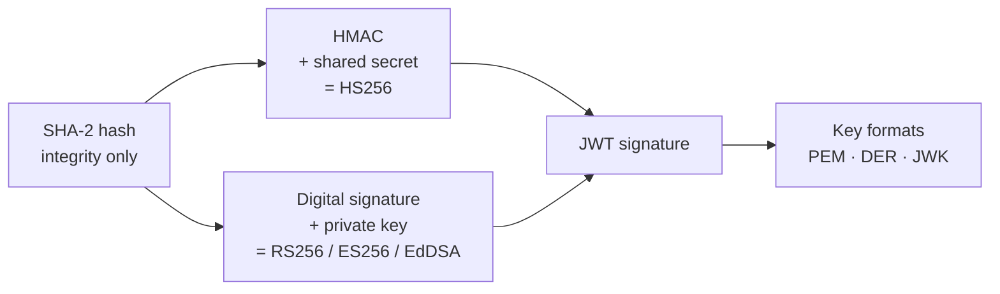

# 🔬 Module 13 · Cryptography Deep Dive

> *"A JWT is cryptography wearing a JSON costume."*

Every signing algorithm in PyJWT — `HS256`, `RS256`, `ES256`, `PS256`, `EdDSA` —
is a thin wrapper around classic cryptographic primitives. This module strips
the costume off and rebuilds the machinery from the ground up: **hashes →
MACs → digital signatures → key formats → the full algorithm zoo.**

By the end you'll be able to recompute an HS256 signature *by hand* and explain
exactly why you can publish an RSA public key to the entire internet.

---

## 🧠 The mental model



- A **hash** proves the bits didn't change *by accident* (integrity), but anyone
  can recompute it — no authenticity.
- Add a **shared secret** → **HMAC** → that's `HS256`.
- Add a **private/public key pair** → **digital signature** → that's
  `RS256` / `ES256` / `PS256` / `EdDSA`.
- Keys travel as **PEM**, **DER**, or **JWK** depending on where they're used.

---

## 📜 Scripts in this module

| # | Script | What it teaches | Run |
|---|--------|-----------------|-----|
| 01 | [`01_hashing_sha2.py`](01_hashing_sha2.py) | SHA-256/384/512 digests, one-way hashing, fixed size, the avalanche effect | `.venv/bin/python pyjwt-course/13-cryptography-deep-dive/01_hashing_sha2.py` |
| 02 | [`02_why_hashes_arent_enough.py`](02_why_hashes_arent_enough.py) | A bare hash gives integrity but **not** authenticity — an attacker just recomputes it | `.venv/bin/python pyjwt-course/13-cryptography-deep-dive/02_why_hashes_arent_enough.py` |
| 03 | [`03_hmac_from_scratch.py`](03_hmac_from_scratch.py) | **The aha:** recompute HMAC-SHA256 and prove it equals the HS256 token's 3rd segment | `.venv/bin/python pyjwt-course/13-cryptography-deep-dive/03_hmac_from_scratch.py` |
| 04 | [`04_symmetric_vs_asymmetric.py`](04_symmetric_vs_asymmetric.py) | One shared secret vs. a key pair + a full tradeoff table | `.venv/bin/python pyjwt-course/13-cryptography-deep-dive/04_symmetric_vs_asymmetric.py` |
| 05 | [`05_digital_signatures.py`](05_digital_signatures.py) | Sign with the RSA private key, verify with the public key — the engine behind `RS256` | `.venv/bin/python pyjwt-course/13-cryptography-deep-dive/05_digital_signatures.py` |
| 06 | [`06_public_key_crypto_intuition.py`](06_public_key_crypto_intuition.py) | Trapdoor functions: why publishing a public key is safe; RSA vs. ECDSA | `.venv/bin/python pyjwt-course/13-cryptography-deep-dive/06_public_key_crypto_intuition.py` |
| 07 | [`07_key_formats_pem_der_jwk.py`](07_key_formats_pem_der_jwk.py) | One RSA public key serialized as PEM, DER (hex), and JWK | `.venv/bin/python pyjwt-course/13-cryptography-deep-dive/07_key_formats_pem_der_jwk.py` |
| 08 | [`08_algorithm_family_tour.py`](08_algorithm_family_tour.py) | Sign with one alg per family; compare header `alg` + signature lengths | `.venv/bin/python pyjwt-course/13-cryptography-deep-dive/08_algorithm_family_tour.py` |

> Run everything at once:
> ```bash
> for f in pyjwt-course/13-cryptography-deep-dive/0*.py; do .venv/bin/python "$f"; done
> ```

---

## 🔑 Key takeaways

1. **`HS256` is `base64url(HMAC-SHA256(header.payload, secret))`.** Script 03
   proves it byte-for-byte. Once you see it, JWTs stop being magic.
2. **Hash ≠ MAC ≠ signature.** A hash gives integrity; a MAC (HMAC) adds
   authenticity with a *shared* secret; a signature adds authenticity with a
   *private* key that the verifier never sees.
3. **Sign = private, verify = public.** This single sentence explains why
   identity providers can publish keys via JWKS and the world can verify their
   tokens without ever being able to forge one.
4. **Trapdoor functions** (factoring for RSA, discrete log for EC) make it
   infeasible to derive the private key from the public key.
5. **PEM / DER / JWK are the same key, different clothes.** JWKS endpoints serve
   JWK; PyJWT arguments usually want PEM; DER is the underlying binary.

---

## ⚠️ Pitfalls

- **Don't confuse hashing with encryption.** Hashing is one-way; there is no
  "unhash". You cannot recover a payload from a signature.
- **Never compare signatures with `==`.** Use `hmac.compare_digest` to avoid
  timing side-channels (PyJWT does this for you internally).
- **HMAC keys should be ≥ 32 bytes** for SHA-256 (RFC 7518 §3.2). Short secrets
  trigger PyJWT's `InsecureKeyLengthWarning`.
- **ECDSA and RSA-PSS signatures are randomised** — the same input yields a
  different signature each run. That's by design, not a bug.

➡️ Next: [Module 14 · Security Best Practices](../14-security-best-practices/) —
where this crypto knowledge becomes your defense against real attacks.
