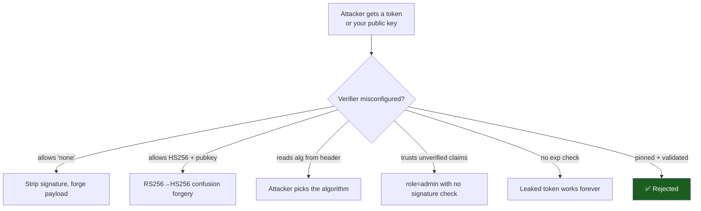

# 🛡️ Module 14 · Security Best Practices

> *"JWTs are easy to use and easy to misuse. This module is about the second part."*

A JWT is a **bearer credential**: whoever holds a valid one is treated as the
subject. That power makes configuration mistakes catastrophic. This module walks
through the classic JWT footguns — `alg: none`, algorithm confusion, trusting
unverified claims, missing expiry, weak secrets, leaky payloads — and shows the
exact defense for each, with code that actually demonstrates both the attack and
the fix.

---

## 🎯 The threat model at a glance



Every red path collapses to **one root cause: the verifier trusted something the
attacker controls.** The fix is always: *pin the algorithm, verify the claims,
guard the keys.*

---

## 📜 Scripts in this module

| # | Script | Attack / topic | Run |
|---|--------|----------------|-----|
| 01 | [`01_alg_none_attack.py`](01_alg_none_attack.py) | The unsecured `alg: none` token; PyJWT refuses it unless you dangerously opt in | `.venv/bin/python pyjwt-course/14-security-best-practices/01_alg_none_attack.py` |
| 02 | [`02_always_pin_algorithms.py`](02_always_pin_algorithms.py) | Why `algorithms=[...]` is mandatory; never echo the token's own `alg` | `.venv/bin/python pyjwt-course/14-security-best-practices/02_always_pin_algorithms.py` |
| 03 | [`03_algorithm_confusion_rsa_hmac.py`](03_algorithm_confusion_rsa_hmac.py) | **RS256→HS256 forgery** that actually succeeds vs. a vulnerable verifier, then the fix | `.venv/bin/python pyjwt-course/14-security-best-practices/03_algorithm_confusion_rsa_hmac.py` |
| 04 | [`04_never_trust_unverified_claims.py`](04_never_trust_unverified_claims.py) | `verify_signature=False` is for routing only, never for trust | `.venv/bin/python pyjwt-course/14-security-best-practices/04_never_trust_unverified_claims.py` |
| 05 | [`05_expiration_is_mandatory.py`](05_expiration_is_mandatory.py) | No `exp` = forever; enforce short TTL + `require: ['exp']` | `.venv/bin/python pyjwt-course/14-security-best-practices/05_expiration_is_mandatory.py` |
| 06 | [`06_secret_management.py`](06_secret_management.py) | Strong secrets via `secrets.token_urlsafe`, env vars, weak-vs-strong entropy | `.venv/bin/python pyjwt-course/14-security-best-practices/06_secret_management.py` |
| 07 | [`07_dont_put_secrets_in_payload.py`](07_dont_put_secrets_in_payload.py) | The payload is readable by anyone — extract claims with no key | `.venv/bin/python pyjwt-course/14-security-best-practices/07_dont_put_secrets_in_payload.py` |
| 08 | [`08_security_checklist.py`](08_security_checklist.py) | A printable, actionable JWT security checklist | `.venv/bin/python pyjwt-course/14-security-best-practices/08_security_checklist.py` |

> Run everything at once:
> ```bash
> for f in pyjwt-course/14-security-best-practices/0*.py; do .venv/bin/python "$f"; done
> ```

---

## 💥 The star of the show: algorithm confusion (script 03)

The exploit in one breath: an RS256 server's **public key is public**. HS256 is
**symmetric** (same key signs and verifies). So an attacker uses the public key
as an HMAC secret to forge an HS256 token — and a server that allows
`algorithms=["HS256","RS256"]` with that public key "verifies" it.

Script 03 demonstrates **all three outcomes for real**:

1. ✅ **Forgery succeeds** against a naive/legacy verifier (models the
   historically vulnerable behavior).
2. 🛡️ **Modern PyJWT blocks it** — it refuses to use an asymmetric PEM as an
   HMAC secret (`InvalidKeyError`). A genuinely valuable built-in defense.
3. 🔒 **The fix you own:** pin `algorithms=["RS256"]` only → the forged token is
   rejected with `InvalidAlgorithmError`, while genuine RS256 tokens still pass.

> Don't rely on the library's guard alone — **pin your algorithms explicitly.**

---

## 🔑 Key takeaways

1. **Pin the algorithm.** `jwt.decode(token, key, algorithms=["RS256"])` — exact
   and minimal. Never read `alg` from the token, never include `none`, never mix
   symmetric and asymmetric.
2. **Verify the claims.** `exp` (and `require` it), `aud`, `iss`. Fail closed.
3. **Guard the keys.** Strong random secrets, env/secret-manager storage,
   rotation, `kid` allowlists, asymmetric keys for third-party verification.
4. **The payload is public.** Signing ≠ encryption. Never place secrets/PII in
   claims.
5. **Unverified ≠ trusted.** Decode-without-verify is plumbing for choosing a
   key; trust only flows from a signature you validated.

---

## ⚠️ Pitfalls

- Allowing `none` "just for testing" and shipping it.
- Copy-pasting `algorithms=[jwt.get_unverified_header(t)["alg"]]` from a blog.
- Forgetting `audience=`/`issuer=`, so a valid token *from another app* passes.
- Long-lived (or eternal) access tokens with no revocation plan.
- Treating base64url as if it were encryption.

➡️ Next: [Module 15 · Real-World FastAPI & OAuth2/OIDC](../15-real-world-fastapi-oauth/)
— apply all of this in a production-shaped auth flow.
