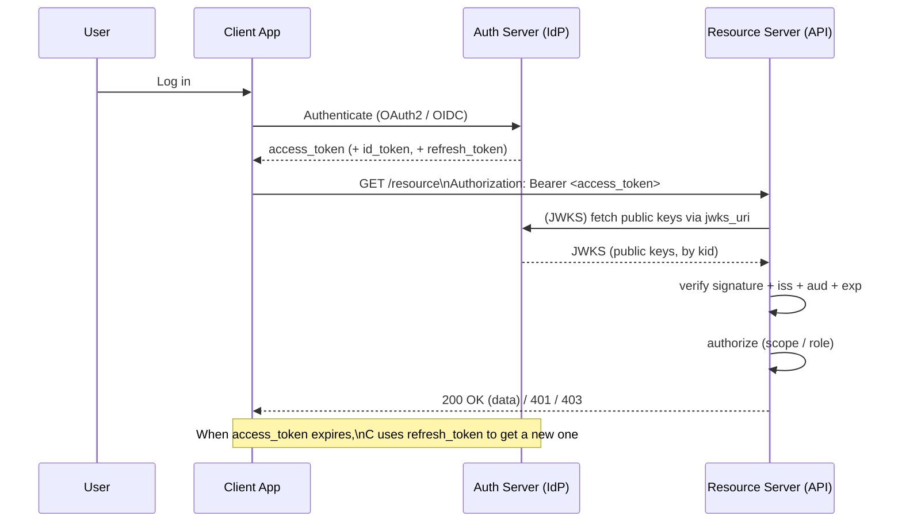
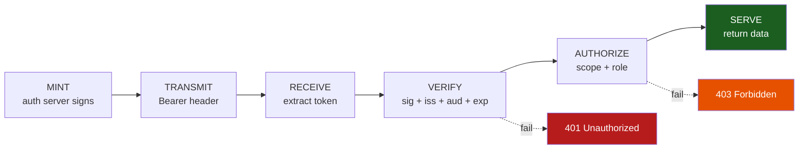

# 🚀 Module 15 · Real-World FastAPI & OAuth2 / OIDC

> *"Everything before this module was practice. This is the game."*

Here we assemble the whole course into the patterns you actually ship: an
authorization server that **issues** tokens, a resource server that **verifies**
them, short-lived access tokens backed by **refresh tokens**, a **FastAPI**
dependency that protects routes, **scope-based authorization**, **OIDC id_token**
validation against a **JWKS**, and the canonical **Microsoft Entra ID** pattern
(mirrored offline, with the live Azure code in comments).

Every script runs self-contained — RSA/EC keys and JWKS are generated locally,
so there's no network dependency, yet the code is shaped exactly like
production.

---

## 🔄 The OAuth2 / OIDC token flow



---

## 🔐 The request auth lifecycle (script 08)



**Identity** (verify) and **permission** (authorize) are two separate gates.

---

## 📜 Scripts in this module

| # | Script | What it builds | Run |
|---|--------|----------------|-----|
| 01 | [`01_issue_access_token.py`](01_issue_access_token.py) | Auth server that mints HS256 & RS256 access tokens with realistic claims | `.venv/bin/python pyjwt-course/15-real-world-fastapi-oauth/01_issue_access_token.py` |
| 02 | [`02_verify_access_token.py`](02_verify_access_token.py) | Resource-server verifier enforcing `iss` / `aud` / `exp` | `.venv/bin/python pyjwt-course/15-real-world-fastapi-oauth/02_verify_access_token.py` |
| 03 | [`03_access_and_refresh_tokens.py`](03_access_and_refresh_tokens.py) | Short access + long refresh tokens; a `refresh()` exchange function | `.venv/bin/python pyjwt-course/15-real-world-fastapi-oauth/03_access_and_refresh_tokens.py` |
| 04 | [`04_fastapi_dependency.py`](04_fastapi_dependency.py) | FastAPI `Depends` Bearer guard protecting `/me`, tested in-process | `.venv/bin/python pyjwt-course/15-real-world-fastapi-oauth/04_fastapi_dependency.py` |
| 05 | [`05_scopes_and_authorization.py`](05_scopes_and_authorization.py) | OAuth2 `scope` claim + a `require_scope()` guard (allow/deny) | `.venv/bin/python pyjwt-course/15-real-world-fastapi-oauth/05_scopes_and_authorization.py` |
| 06 | [`06_oidc_id_token_validation.py`](06_oidc_id_token_validation.py) | OIDC `id_token` claims + validation against a local JWKS by `kid` | `.venv/bin/python pyjwt-course/15-real-world-fastapi-oauth/06_oidc_id_token_validation.py` |
| 07 | [`07_entra_id_validation_pattern.py`](07_entra_id_validation_pattern.py) | The canonical Entra ID / Azure AD pattern (offline mirror + live code in comments) | `.venv/bin/python pyjwt-course/15-real-world-fastapi-oauth/07_entra_id_validation_pattern.py` |
| 08 | [`08_putting_it_all_together.py`](08_putting_it_all_together.py) | Capstone: mint → transmit → verify → authorize, stage by stage | `.venv/bin/python pyjwt-course/15-real-world-fastapi-oauth/08_putting_it_all_together.py` |

> Run everything at once:
> ```bash
> for f in pyjwt-course/15-real-world-fastapi-oauth/0*.py; do .venv/bin/python "$f"; done
> ```

---

## 🟦 The Microsoft Entra ID pattern (script 07)

This is the production code shape, identical to the repo's
[`tests/validate.py`](../../tests/validate.py):

```python
from jwt import PyJWKClient

JWKS_URL = f"https://login.microsoftonline.com/{TENANT_ID}/discovery/v2.0/keys"
ISSUER   = f"https://login.microsoftonline.com/{TENANT_ID}/v2.0"

jwk_client  = PyJWKClient(JWKS_URL)                       # downloads + caches keys
signing_key = jwk_client.get_signing_key_from_jwt(token)  # picks the key by 'kid'
claims = jwt.decode(
    token, signing_key.key, algorithms=["RS256"],
    audience=CLIENT_ID, issuer=ISSUER,
)
```

`PyJWKClient` fetches Microsoft's **public** keys from the tenant's `jwks_uri`,
uses the token's `kid` to choose the right one, and `jwt.decode` does the rest.
Script 07 runs an **offline simulation** of exactly these steps (local key +
local JWKS + `kid` selection) so it works with no network, and keeps the live
Azure version in `validate_token_azure()` for reference.

> ℹ️ Note: `fastapi.testclient.TestClient` needs `httpx`. In this environment
> `httpx` isn't installed, so script 04 automatically falls back to calling the
> dependency function directly — still exercising the valid / invalid / missing
> token paths, still exiting 0.

---

## 🔑 Key takeaways

1. **Issue rich, scoped, time-boxed tokens** — `iss`, `sub`, `aud`, `iat`,
   `exp`, `scope`. The verifier enforces every one.
2. **Access vs. refresh.** Keep access tokens short; renew with a separately
   keyed refresh token. Never accept an access token in the refresh slot.
3. **Protect routes with a dependency.** One `Depends(get_current_user)` gates a
   route; invalid → 401.
4. **Separate authN from authZ.** A valid signature proves *who*; scope/role
   checks decide *what they may do* → 403 when insufficient.
5. **JWKS + `kid` is how the internet verifies tokens.** OIDC providers and
   Entra ID publish public keys; clients select by `kid` and pin `RS256` + `aud`
   + `iss`.

---

## ⚠️ Pitfalls

- Verifying signature but forgetting `audience=`/`issuer=` → tokens from another
  app/tenant slip through.
- Long-lived access tokens with no refresh strategy.
- Confusing `scope` (what the app may do) with identity (`sub`).
- Trusting an `id_token` without checking `aud == client_id` and the `nonce`.
- Fetching keys from a `kid`/`jku` the token itself supplies — always validate
  `kid` against a known JWKS / allowlist.

🎓 You've reached the end of the course. Go build something — and verify every
token. 🔐
