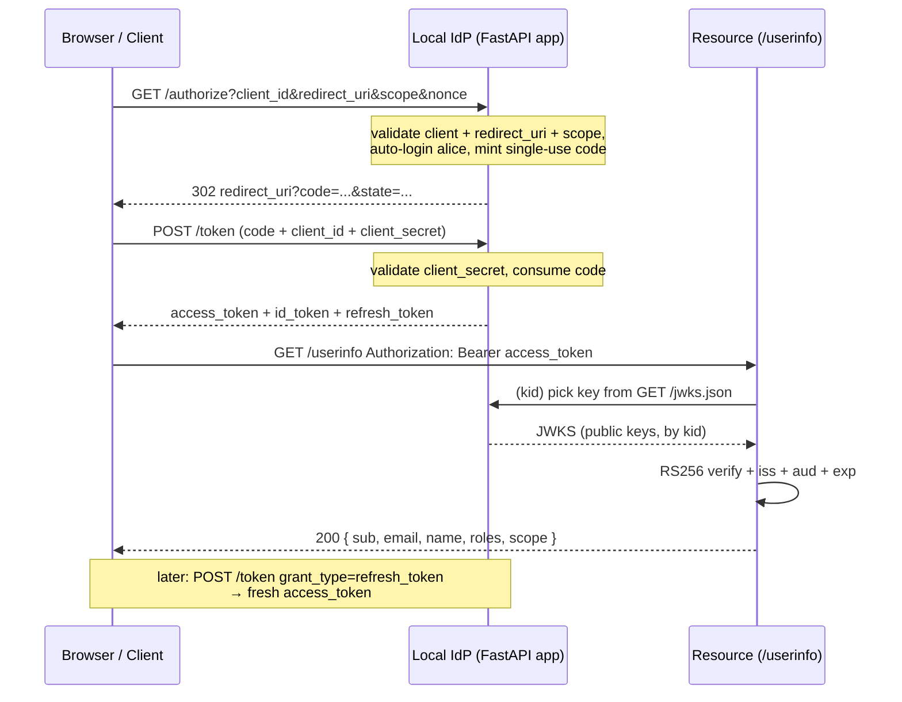

# 🏛️ Module 16 · Build Your Own Local Identity Provider

> *"You've spent 15 modules verifying other people's tokens. Now you become the
> one who issues them."*

This module ships a **fully local, offline OAuth2 + OpenID Connect (OIDC)
identity provider** built on FastAPI + PyJWT + cryptography. It mirrors the exact
shape of Microsoft Entra ID / Google / Auth0 — discovery document, JWKS,
authorize, token, userinfo — so you can run the **complete authorization-code
flow**, validate tokens against a **JWKS**, exchange **refresh tokens**, and
watch **key rotation** happen live, all without a single network call and
without an Azure subscription.

Every numbered script drives the provider **in-process** with
`fastapi.testclient.TestClient`, so it runs to completion and exits `0`. A real
`uvicorn` entrypoint is provided for interactive use.

---

## 🧭 OAuth2 authorization-code + OIDC, in one paragraph

In the **authorization-code flow**, your app never sees the user's password. It
sends the browser to the IdP's `/authorize` endpoint; the user authenticates;
the IdP hands back a single-use **code** at your redirect URI. Your backend then
POSTs that code (plus its `client_secret`) to `/token` and receives an
**access_token** (a key to an API), an **id_token** (OIDC proof of *who* logged
in), and a **refresh_token** (to get fresh access tokens later). The API
validates the access token by fetching the IdP's public keys from its **JWKS**
and checking the RS256 signature, `iss`, `aud`, and `exp`. OIDC is the thin
identity layer on top of OAuth2 that adds the `id_token` and the discovery/JWKS
conventions.

---

## 🏗️ Architecture

```
        ┌──────────────────────────── idp package ────────────────────────────┐
        │  keys.py   RSA-2048 signing keys (current + next), JWKS, rotation    │
        │  server.py FastAPI `app`: discovery · jwks · authorize · token · …   │
        │  client.py in-process TestClient driver for the demos                │
        └──────────────────────────────────────────────────────────────────────┘
                 ▲                              ▲                        ▲
   01/02 discovery+jwks          03 auth-code · 06 refresh      04/05/07/08 validate
```

* **Signing**: every token is **RS256** with the signing key's `kid` in the JWT
  header. The provider holds two keys at once (`current` + `next`) and publishes
  both, so validation survives a rotation window.
* **Access token** → audience = the resource API (`api://local-resource`),
  carries `iss/aud/sub/exp/iat/scope/roles/jti`.
* **id_token** → audience = the `client_id`, carries `nonce/email/name`.
* **Stores** are in-memory: a user (`alice`) and a confidential client
  (`local-web-app`).

---

## 🔄 The full flow (sequence diagram)



---

## 📜 Scripts in this module

Run each from the repo root (`/home/astro/catalyst/jwt-test`):

| # | Script | What it teaches | Command |
|---|--------|-----------------|---------|
| 01 | Discovery document | The `.well-known/openid-configuration` manifest, field by field | `uv run python pyjwt-course/16-local-identity-provider/01_discovery_document.py` |
| 02 | JWKS endpoint | Public keys, `kid` routing, why two keys are published | `uv run python pyjwt-course/16-local-identity-provider/02_jwks_endpoint.py` |
| 03 | Authorization-code flow | `/authorize` → code → `/token` → tokens, decoded | `uv run python pyjwt-course/16-local-identity-provider/03_authorization_code_flow.py` |
| 04 | Validate with JWKS | Verify the access token exactly like `tests/validate.py`, plus a tampered-token failure | `uv run python pyjwt-course/16-local-identity-provider/04_validate_with_jwks.py` |
| 05 | userinfo endpoint | The protected resource; 200 vs 401 | `uv run python pyjwt-course/16-local-identity-provider/05_userinfo_endpoint.py` |
| 06 | Refresh-token flow | Swap a refresh token for a fresh access token | `uv run python pyjwt-course/16-local-identity-provider/06_refresh_token_flow.py` |
| 07 | id_token & nonce | OIDC id_token validation + the nonce round-trip | `uv run python pyjwt-course/16-local-identity-provider/07_id_token_and_nonce.py` |
| 08 | Live key rotation | Rotate `current`→`next`, prove published keys validate and a retired key fails | `uv run python pyjwt-course/16-local-identity-provider/08_key_rotation_live.py` |

> The numbered scripts **never** start a blocking server — they drive the FastAPI
> `app` in-process. `idp/server.py` is for **live** use and is **not**
> auto-executed by any script.

---

## 🖥️ Running the live server (optional, interactive)

To poke the provider with `curl`/Postman/a browser, run it under uvicorn. Because
the folder name contains hyphens, point uvicorn at it with `--app-dir`:

```bash
uv run uvicorn idp.server:app \
    --app-dir pyjwt-course/16-local-identity-provider \
    --port 9000
```

Then try:

```bash
curl http://localhost:9000/.well-known/openid-configuration
curl http://localhost:9000/jwks.json
```

The `issuer` is fixed at `http://localhost:9000`, so run it on port **9000** for
the tokens' `iss` to match the live URL.

---

## 🔁 Local endpoint ↔ Azure Entra ID equivalent

| Local IdP (module 16) | Microsoft Entra ID equivalent |
|-----------------------|-------------------------------|
| `GET http://localhost:9000/.well-known/openid-configuration` | `https://login.microsoftonline.com/{tenant}/v2.0/.well-known/openid-configuration` |
| `GET http://localhost:9000/jwks.json` | `https://login.microsoftonline.com/{tenant}/discovery/v2.0/keys` |
| `GET http://localhost:9000/authorize` | `https://login.microsoftonline.com/{tenant}/oauth2/v2.0/authorize` |
| `POST http://localhost:9000/token` | `https://login.microsoftonline.com/{tenant}/oauth2/v2.0/token` |
| `GET http://localhost:9000/userinfo` | `https://graph.microsoft.com/oidc/userinfo` |
| `issuer` = `http://localhost:9000` | `iss` = `https://login.microsoftonline.com/{tenant}/v2.0` |
| `client_id` = `local-web-app` | your app registration's **Application (client) ID** |
| `client_secret` = `local-web-app-secret` | a **client secret** from the app registration |
| access-token `aud` = `api://local-resource` | the API's **Application ID URI** |
| signing key `kid` (`local-key-XXXX`) | Microsoft's rotating signing-key `kid` |

The validation code is identical in shape to this repo's `tests/validate.py` and
module 15's `07_entra_id_validation_pattern.py` — only the JWKS URL changes.

---

## 🎯 Key takeaways

- An **IdP signs with a private key and publishes the public key as a JWKS**;
  resource servers verify with that public key — they never hold a secret.
- The **`kid` header** is the routing glue: it tells the verifier which JWKS key
  to use, which is what makes **zero-downtime key rotation** possible.
- **access_token (`aud` = API)** and **id_token (`aud` = client_id)** answer two
  different questions: *what may I call?* vs *who is this user?*
- The **nonce** binds an id_token to the exact login request that asked for it.
- **Refresh tokens** trade a long-lived credential for short-lived access tokens
  so a leaked access token expires fast.
- Swapping `localhost:9000` for a real provider's discovery URL is the *only*
  change needed to point this code at Azure/Google.
