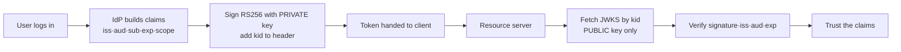

# 🧠 Mental Model — Behind the Scenes

## How an identity provider issues and verifies trust

Picture a **passport office** (the identity provider) and a **border agent**
(your API). You don't expect the border agent to phone the passport office and
re-check your fingerprints every time you cross. Instead, the passport office
**signs** your passport with a tamper-evident seal, and publishes a catalogue of
its official seals. Any border agent who trusts that catalogue can verify your
passport on the spot — offline, in milliseconds.

A JWT-issuing IdP works exactly like that.

### Issuing (the passport office)

When a user logs in, the IdP gathers the facts it's willing to vouch for —
*who* the user is (`sub`, `email`, `name`), *what* they may do (`scope`,
`roles`), and *for how long* (`exp`) — and packs them into a JSON payload. It
then signs that payload with the **private half** of an RSA keypair using
**RS256**. The signature is a number that only the holder of the private key
could have produced, yet *anyone* with the public key can check. Crucially, the
IdP stamps the token's header with a **`kid`** — the id of the exact key it
signed with — so the verifier knows which seal to look up.

The private key never leaves the IdP. What the IdP *does* share, freely and
publicly, is the matching **public key**, served as a **JWKS** (JSON Web Key
Set) at a stable URL.

### Verifying (the border agent)

The resource server receives `Authorization: Bearer <token>`. It reads the
**unverified** header just to learn the `kid`, fetches the IdP's JWKS, and picks
the public key whose `kid` matches. Then it runs `jwt.decode(...)`, which
re-computes the signature and rejects anything tampered, expired, issued by the
wrong party (`iss`), or meant for someone else (`aud`). No shared password, no
callback to the IdP — just public-key math.

### Why the catalogue has more than one seal

Passport offices retire old seals and mint new ones. If they swapped instantly,
every passport signed yesterday would suddenly look forged. So they keep the
**old and new seal in the public catalogue at once** and route by seal id. That
is precisely why a JWKS publishes a *set* of keys and tokens carry a `kid`:
rotation becomes invisible to everyone holding a still-valid token, while
retired keys quietly age out and their tokens stop validating.

That single idea — **sign privately, verify publicly, route by `kid`** — is the
entire trust backbone behind Microsoft Entra ID, Google, Auth0, and the local
provider you just built.
