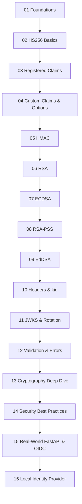

# 🔐 The Complete PyJWT Course

> A hands-on, end-to-end journey through JSON Web Tokens (JWT) using Python's
> [`PyJWT`](https://pyjwt.readthedocs.io/) library — from the raw bytes of a
> token all the way to production-grade OAuth2 / OpenID Connect flows, with a
> deep dive into the cryptography that makes it all work.

---

## 🎯 Who this is for

You already know a little Python and you've poked at `jwt.encode()` /
`jwt.decode()`. Now you want to *truly* understand:

- What the three parts of a JWT actually are (and why they're base64url, not base64).
- Every signing algorithm family — **HMAC**, **RSA**, **ECDSA**, **RSA-PSS**, **EdDSA** — and *when to choose which*.
- The cryptography underneath: hashing, MACs, public-key signatures, key formats.
- How to validate tokens safely, rotate keys with **JWKS**, and avoid the classic JWT security footguns.
- How real identity providers (like Microsoft Entra ID / Azure AD) issue and validate tokens.

Every concept ships with **runnable, verified** code. If a script is in this
course, it has been executed and its output checked.

---

## 🧭 How to run the examples

All examples are written for the project virtual environment:

```bash
# from the repo root: /home/astro/catalyst/jwt-test
.venv/bin/python pyjwt-course/01-foundations/01_anatomy_of_a_jwt.py
```

- **Python:** 3.13
- **PyJWT:** 2.13.0
- **cryptography:** 49.0.0

Each script is standalone and prints clearly labelled output. No network access
is required for any example except where explicitly noted (the real-world OIDC
module).

---

## 📚 Curriculum map

| # | Module | What you'll learn |
|---|--------|-------------------|
| 01 | [Foundations](01-foundations/) | JWT anatomy, base64url, claims vs. signature, decoding *without* a key |
| 02 | [Getting started with HS256](02-getting-started-hs256/) | Your first encode/decode, secrets, round-trips, bytes vs. str |
| 03 | [Registered claims](03-registered-claims/) | `iss`, `sub`, `aud`, `exp`, `nbf`, `iat`, `jti` and how PyJWT validates them |
| 04 | [Custom claims & validation options](04-custom-claims-and-validation/) | Custom payload data, `options=`, `require=`, selectively disabling checks |
| 05 | [HMAC algorithms](05-hmac-algorithms/) | `HS256` / `HS384` / `HS512` — shared-secret signing |
| 06 | [RSA algorithms](06-rsa-algorithms/) | `RS256` / `RS384` / `RS512` — key pairs, PEM, public/private split |
| 07 | [ECDSA algorithms](07-ecdsa-algorithms/) | `ES256` / `ES384` / `ES512` / `ES256K` — elliptic curves |
| 08 | [RSA-PSS algorithms](08-rsa-pss-algorithms/) | `PS256` / `PS384` / `PS512` — probabilistic RSA signatures |
| 09 | [EdDSA algorithms](09-eddsa-algorithms/) | `Ed25519` / `Ed448` — modern, fast, misuse-resistant signatures |
| 10 | [Headers & `kid`](10-headers-and-kid/) | The JOSE header, custom headers, `get_unverified_header`, key IDs |
| 11 | [JWKS & key rotation](11-jwks-and-key-rotation/) | `PyJWKClient`, `PyJWKSet`, JWK format, rotating signing keys |
| 12 | [Validation, errors & leeway](12-validation-errors-and-leeway/) | The full exception hierarchy, clock skew, graceful failure |
| 13 | [Cryptography deep dive](13-cryptography-deep-dive/) | Hashes, HMAC, asymmetric crypto, digital signatures from scratch |
| 14 | [Security best practices](14-security-best-practices/) | `alg=none`, algorithm-confusion attacks, and how to defend |
| 15 | [Real-world: FastAPI & OAuth2/OIDC](15-real-world-fastapi-oauth/) | Auth dependencies, refresh tokens, Entra ID validation |
| 16 | [Local identity provider](16-local-identity-provider/) | A fully local OAuth2/OIDC server — discovery, JWKS, /token, /userinfo, rotation |

> **118 runnable examples** across 16 modules — every script has been executed with `uv run` and exits cleanly.

### ▶️ Run everything at once

```bash
# from the repo root: /home/astro/catalyst/jwt-test (uses uv — no venv activation)
for f in $(find pyjwt-course -name '[0-9][0-9]_*.py' | sort); do
    echo "=== $f ==="; uv run python "$f" || echo "FAILED: $f";
done
```

### 🌐 The interactive website

This course ships with a **stunning, offline-capable static site** (dark theme,
Lottie animations, Mermaid diagrams, an in-browser JWT decoder, and the real
captured output of every example). Build & serve it locally:

```bash
uv run --with markdown --with pygments python sitegen/build.py   # generate ../site
cd site && uv run python -m http.server 8777                     # then open http://localhost:8777
```

---

## 🗺️ Suggested learning path



---

## 🔑 The one-paragraph summary of JWTs

A JWT is three base64url-encoded chunks joined by dots:
`header.payload.signature`. The **header** says which algorithm signed the
token. The **payload** carries *claims* (statements about a user/session). The
**signature** is a cryptographic proof, computed over `header.payload`, that
lets a verifier confirm the token wasn't tampered with — using either a **shared
secret** (HMAC) or a **public/private key pair** (RSA, ECDSA, EdDSA). JWTs are
*signed, not encrypted*: anyone can read the payload, so never put secrets in it.

Now go open [`01-foundations/`](01-foundations/) and let's begin. 🚀
