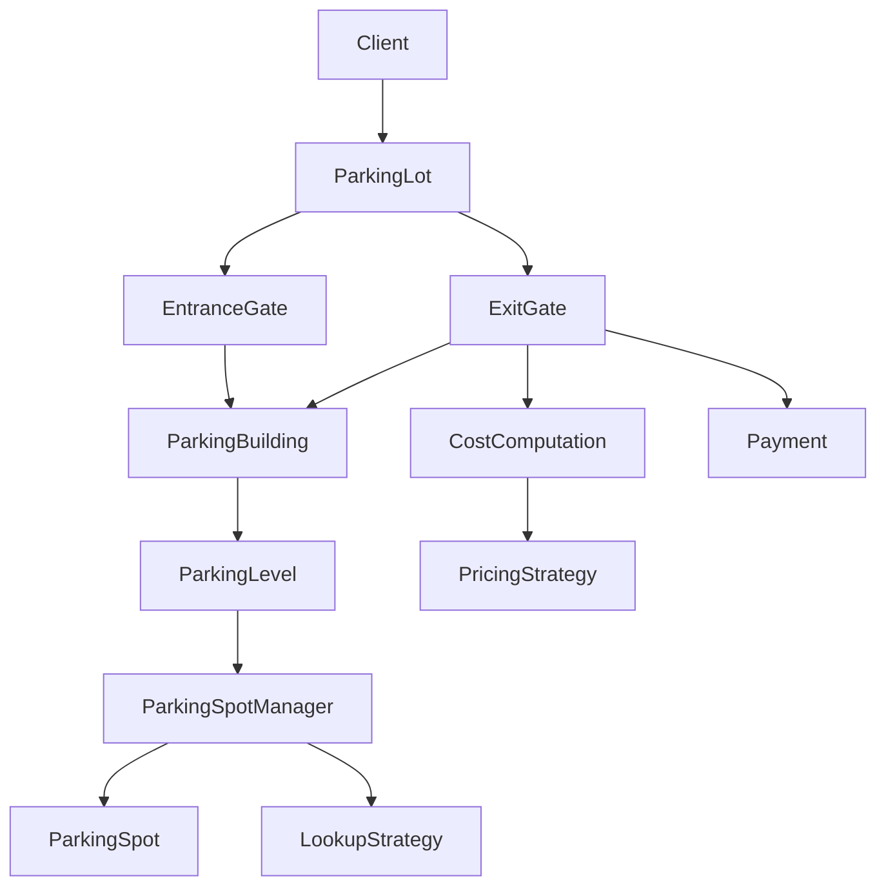

# Parking Lot - Design Flow

> Quick-revision notes. Plain words, no jargon.

## The Big Picture

A vehicle arrives, gets a **ticket** with a spot. When it leaves, it pays and the spot is freed.



## Who Does What

| Class | Job |
|---|---|
| `ParkingLot` | Front desk (facade). Only has `vehicleArrives()` and `vehicleExits()`. Just forwards the call. |
| `EntranceGate` | Takes a vehicle in and asks the building to allocate a spot. |
| `ExitGate` | Computes the fee, takes payment, then asks the building to release the spot. |
| `ParkingBuilding` | Holds all levels. Finds a level with space, creates the `Ticket`. |
| `ParkingLevel` | One floor. Picks the right manager by vehicle type (2W / 4W). |
| `ParkingSpotManager` | Owns the spots of one type on one level. Has a lock and a lookup strategy. |
| `ParkingSpotLookupStrategy` | Decides **which** free spot to pick. |
| `ParkingSpot` | A single spot. Just a free / occupied flag and an id. |
| `Ticket` | Vehicle + level + spot + entry time. Carried from entry to exit. |
| `PricingStrategy` / `CostComputation` | Decides **how much** to charge. |
| `Payment` | Cash or UPI. Returns success / failure. |

## Entry Flow (vehicle arrives)

1. Client calls `parkingLot.vehicleArrives(vehicle)`.
2. `ParkingLot` passes it to `EntranceGate.enter(building, vehicle)`.
3. `EntranceGate` calls `building.allocate(vehicle)`.
4. `ParkingBuilding` loops over levels:
   - asks `level.hasAvailability(type)` (is there a manager with a free spot?)
   - if yes, calls `level.park(type)`.
5. `ParkingLevel` looks up the manager in its `Map<VehicleType, ParkingSpotManager>`.
6. `ParkingSpotManager.park()`:
   - takes its lock
   - asks the strategy to select a free spot
   - marks the spot occupied
   - releases the lock (in `finally`)
7. The spot is returned back up to `ParkingBuilding`.
8. `ParkingBuilding` creates `Ticket(vehicle, level, spot)` with `entryTime = now()`.
9. The ticket goes back to the client.
10. If no level has space, it throws `"Parking Full"`.

## Exit Flow (vehicle leaves)

1. Client calls `parkingLot.vehicleExits(ticket, payment)`.
2. `ParkingLot` passes it to `ExitGate.completeExit(building, ticket, payment)`.
3. `ExitGate` asks `CostComputation.compute(ticket)`, which calls `PricingStrategy.calculate(ticket)`.
4. `ExitGate` calls `payment.pay(amount)`.
   - If it fails, it throws and the spot stays occupied.
5. On success, `building.release(ticket)`.
6. `ParkingBuilding` calls `ticket.getLevel().unPark(type, spot)`.
7. `ParkingLevel` finds the manager by type and calls `manager.unPark(spot)`.
8. The manager takes its lock and sets the spot free.
9. The gate opens.

Why the ticket stores **level and spot**: exit can free the exact spot without searching.

## Setup (what `main()` builds)

```
ParkingLot
 +-- ParkingBuilding
 |    +-- Level 1
 |    |    +-- TwoWheelerSpotManager  -> L1-S1, L1-S2
 |    |    +-- FourWheelerSpotManager -> L1-S3
 |    +-- Level 2
 |         +-- TwoWheelerSpotManager  -> L2-S1
 |         +-- FourWheelerSpotManager -> L2-S2, L2-S3
 +-- EntranceGate
 +-- ExitGate (with CostComputation)
```

- A spot is "2W" or "4W" only because of **which manager holds it**. `ParkingSpot` has no type field.

## Patterns Used

- **Strategy** x3: spot lookup, pricing, payment. Swap behaviour without touching the callers.
- **Facade**: `ParkingLot` hides the gates and the building.
- **Delegation chain**: each layer does a small job and passes the rest down.

## Concurrency (Locks)

- Each `ParkingSpotManager` has its own `ReentrantLock(true)` (fair, first come first served).
- A second thread on the same manager **waits** (it does not throw).
- Different managers (2W vs 4W, Level 1 vs Level 2) don't block each other.
- `unlock()` is always in `finally`, so one failure can't block everyone.
- `hasAvailability()` then `park()` are two separate lock calls, so a spot can be taken in between. That's why `allocate()` checks `spot != null` and tries the next level.

## Known Gaps

- `RandomLookupStrategy` is not random; it returns the first free spot.
- `ParkingBuilding` takes a `CostComputation` but never uses it.
- `FixedPricingStrategy` charges 100 regardless of time.
- `Ticket` has no id and no exit time.
- The same ticket can be exited twice.

## Interview Tip

Build the entry flow and exit flow with the smallest classes first (`Vehicle`, `ParkingSpot`, `Ticket`, `ParkingLot`). Add levels, managers, strategies and locks only when asked, and describe them out loud.
